# Auracle X User Guide 

---

Version 2.6.0

For more information about this and other products, please visit the iConnectivity Knowledge Base on the [iConnectivity Support Website](https://www.iconnectivity.com/support-system).

## Installing Auracle X

[Download the latest version of the Auracle X software installer here](https://www.iconnectivity.com/software/control-software)

### Mac Users
## First time Installation
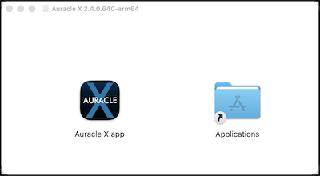

When the Auracle X application has finished downloading open the .dmg file

Drag the Auracle X application to the Applications folder.

### Mac Users: Auracle X update
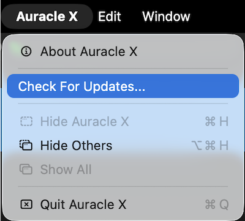

If you already have the Auracle X application installed, use the Auracle X main menu to check for updates and follow the prompts that follow if a newer version of Auracle X is available.

### Windows Users
**First time installation**

When the package installer download is complete, run the Auracle X installer.

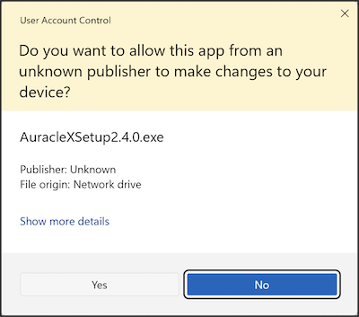

Click Yes to allow Auracle X Setup

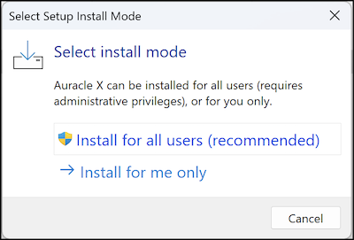

Install for all users

## **Special note regarding interface functionality**

iConnectivity is constantly working to introduce new features and functionality to our audio and MIDI interfaces.   
Please check the link below often to find current firmware release dates and to access release notes including bug fixes and new feature updates:

[https\://www\.iconnectivity.com/firmware](https://www.iconnectivity.com/firmware) 

## Main Menu

### Audio
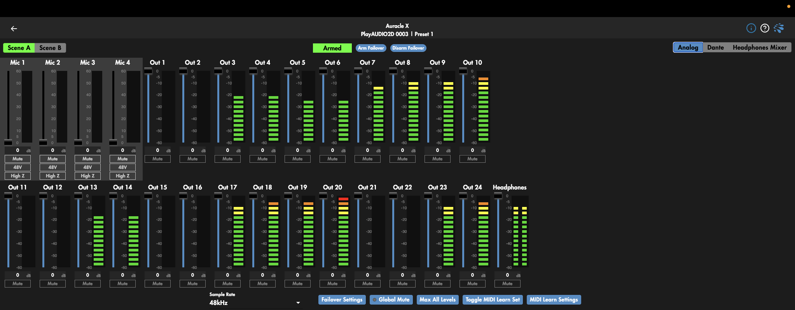

The audio page is customized to the device you are configuring. These pages will contain some items that are universal and some that are specific to the audio interface you are connected to.

Current interface lineup showing the audio page include: PlayAUDIO2D, PlayAUDIO2U, PlayAUDIO1U, PlayAUDIO12, AUDIO4c, AUDIO4+ and AUDIO2+.

Analog audio output and routing can be configured in the following ways on the Audio page: Level, Mute, Stereo/Mono, Headphone Mix, Pan, and Solo.

Analog audio input routing is adjustable for Level, Mute, 48V phantom power, and High Z/ Mic selection.  
Dante receive/input channels can only be edited for mute/unmute.

#### Sample Rate   
At the bottom of the Audio page (you may have to scroll down depending on the size and resolution of your screen), choose the recording sample rate of the AUDIO series interface from between 44.1, 48, 88.2\*, and 96KHz\*.

> **Note:** changing the sampling rate to 88.2 or 96KHz will render a channel change and some modes may be unavailable. After changing sample rates on the PlayAUDIO12 it will be necessary to select an output mode. While no output mode is selected no audio will output from the PlayAUDIO12.

---

### **PlayAUDIO Series Audio Menu Items** 

Both units of our PlayAUDIO series interfaces feature automatic and manual failover, as well as configuration menus for output mode selection, audio mixing, and more

#### Scene Selection  

Select the scene you wish to be active. Scene Selection buttons also respond in real time to scene selection changes made on the interface, and vice versa.  

---

#### Failover Arm/ Disarm selection  

To be able to arm automatic failover you must select a failover signal in the Failover Settings menu item on the bottom of the Audio menu page as well as activate that failover signal. You may arm or disarm automatic failover by clicking the appropriate button above.

---

Tripping the Failover Alarm & Backup Scene Selector

When the Failover alarm is tripped by an interruption in the selected Trigger Mode exceeding your configured audio or MIDI timeout threshold, the Failover Arm / Disarm selection menu will be modified to include a red Failed Over visual alarm, as well as a button to clear the failover alert. Clicking the Clear Failover Alert button will remove the visual alarm but will not toggle the interface to Scene A.

---

#### Output Modes

Both the PlayAUDIO12 and PlayAUDIO1U can be configured to use the ¼” TRS headphone jack as a pair of unbalanced audio outputs using a TRS to dual TS cable (not included), or as a mixable headphone output for monitoring the other outputs. 

| Output Modes | |
| ---- | ---- |
| **Outputs** | Adds headphone outputs left and right as discrete audio outputs 11 and 12 (PlayAUDIO12) or outputs 13 and 14 (PlayAUDIO1U) or outputs 25 and 26 (PlayAUDIO2U) |
| **Headphones** | Calls an additional mixing page allowing you to adjust the levels of each output sending to the headphone output. More info about Headphones mode can be found in the [**Headphones Mode**](#headphones-mode) section of this manual. |
| | |

#### Outputs/Headphones Shared Settings

| Shared Settings | |
| :---- | :---- |
| **Global Mute** | Mutes/unmutes all analog outputs not including headphones output. Mutes the first 24 Dante Transmit channels  on the PlayAUDIO2D. |
| **Max All Levels** | Changes the level of output on rear analog outputs to maximum level |
| | |

> **Note:** The PlayAUDIO2U main audio page defaults to Output mode. Click the Headphone Mixer button to call the headphone mixer page.

---

### Output Mode 

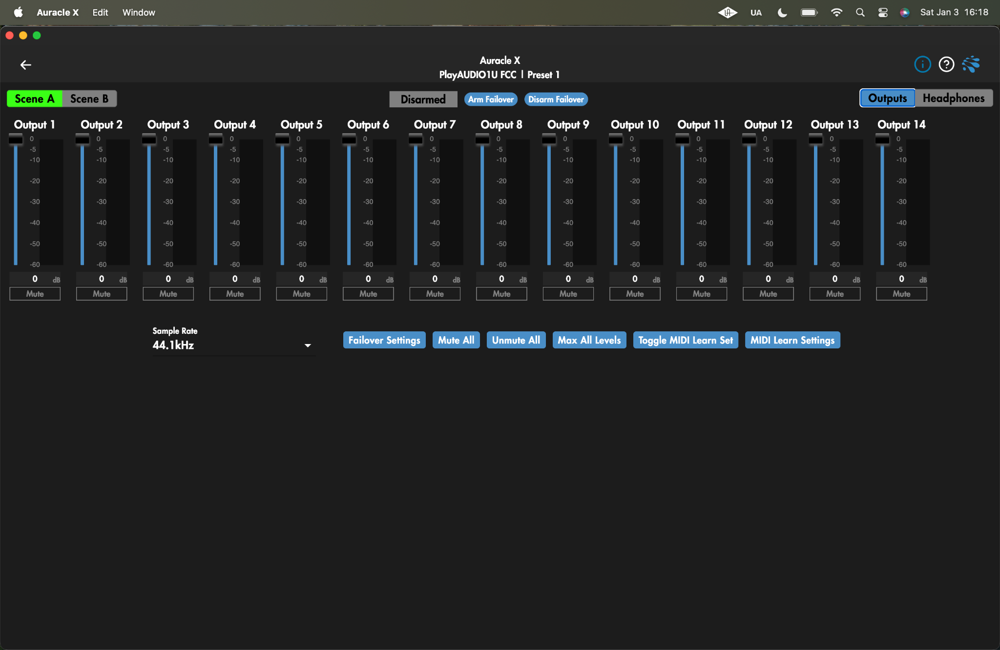

| Faders | Drag fader up or down, or click on the vertical fader travel path to adjust output level |
| :---- | :---- |
| **dB indicator** | Sets and displays audio output level, editable field |
| **Mute** | Mutes or unmutes the signal of the selected output channel |
| | |

### 

### Headphones Mode

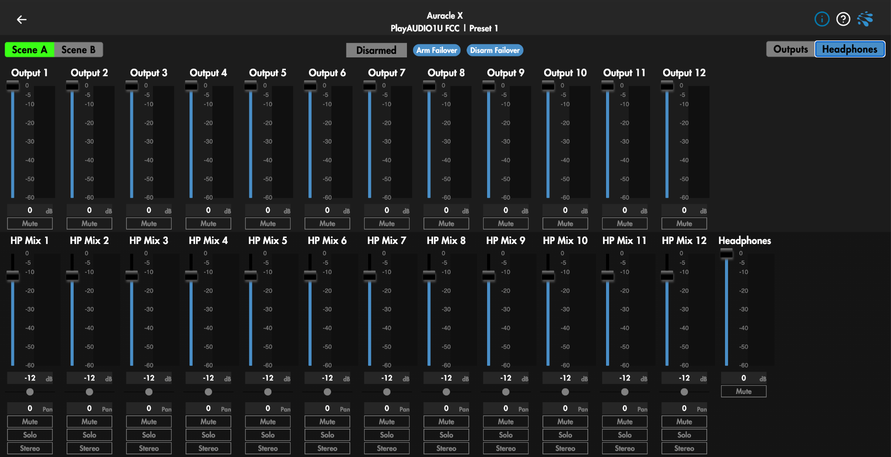

| Headphones Menu | |
| :---- | :---- |
| **Faders** | Changes the audio output level by dragging up or down, or clicking a location in the vertical fader path |
| **dB indicator** | Sets and displays audio output level, editable field |
| **Mute** | Mutes or unmutes the signal of the selected output channel |
| **Solo** | Solos the selected output channel in the headphones mix |
| **Stereo** | Sums sequential odd-even pairs to stereo |
| | |

For more info on the specific audio page data you will see please take a look into our [videos on youtube](https://www.youtube.com/c/iconnectivity) and our user guide for the [AUDIO4c.](https://www.iconnectivity.com/s/iConnectivity-AUDIO4c-User-Guide.pdf)

---

### **PlayAUDIO2D Dante Audio Options**

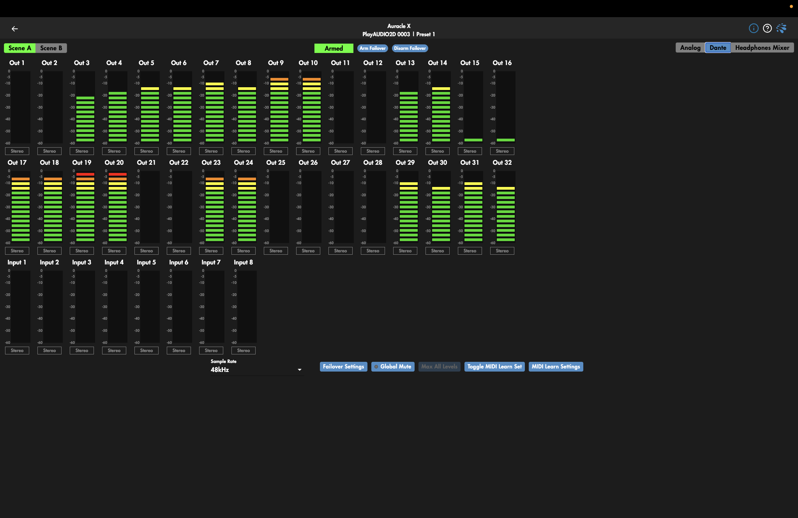

Dante configuration including transmit and receive channel routing must be configured in the [Dante Controller application available here](https://www.getdante.com/products/software-essentials/dante-controller/).

As of firmware version 1.0.3 Dante Transmit and Receive channels are only editable for Stereo grouping via the Stereo button in Auracle X.

The **Global Mute** button controls the mute & unmute function for all rear analog outputs and all Dante transmit channels. 

> **Note:**  Global Mute does not affect the headphone output or the individual input and output mix channels routed to the headphone output.

---

#### **Failover Settings**

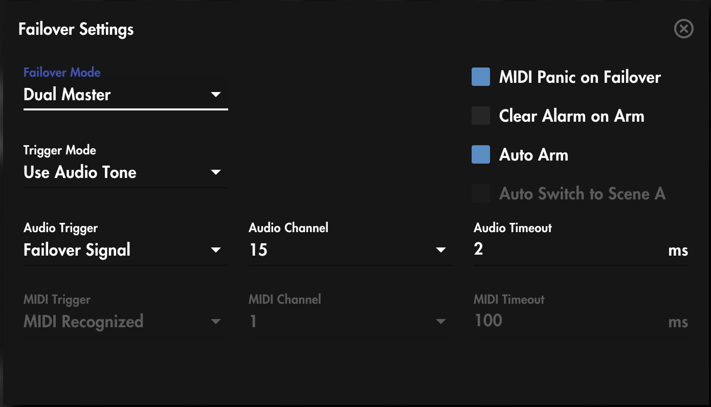

Failover settings are set to a standard default setting seen above but should be configured based on the capabilities and tolerances of your specific rig.

| Failover Settings | |
| :---- | :---- |
| **Failover Mode** | Choose Dual Master to allow a PlayAUDIO interface to recognize an automatic failover signal on both scenes. Choose Single Master to allow automatic failover from scene A to scene B only  |
| **Trigger Mode**  | **Audio Tone**: Use a tone generator like our [LifeSine VST](https://www.iconnectivity.com/software/control-software) to stream a constant tone to a virtual audio channel. Interruptions in the tone above the Audio Timeout threshold will trigger an automatic failover.   **MIDI Stream:** Use a constant MIDI stream like sync or clock to stream a failover signal for automatic failover detection. Interruptions in the MIDI stream above the MIDI timeout threshold will trigger an automatic failover.   **Either**: The PlayAUDIO interface will remain on the current armed scene as long as either an Audio Tone or MIDI Stream is present and unbroken above the respective Audio or MIDI Timeout values.   **Both:** The PlayAUDIO interface will remain on the current armed scene as long as **both** the Audio Tone **and** MIDI Stream remain uninterrupted above the respective Audio or MIDI Timeout values. |
| **Audio Trigger** | **Host Connected**: Automatic failover will be triggered when failover is armed and the Host (device connected to the USB DAW port) is unplugged from the interface.   **Failover Signal:** Automatic failover will be triggered when failover is armed and audio signal on the audio channel selected in the Audio Channel menu is interrupted at or longer than the Audio Timeout threshold. |
| **Audio Channel** | Select the virtual audio channel for a PlayAUDIO interface to listen for failover tone |
| **Audio Time Out** | Set the tone timeout threshold for automatic failover. Spend some time here testing the minimum timeout threshold to find the value that works for your hardware configuration. Some older machines or very large sessions may require longer timeout values to accommodate computing resource limitations. |
| **MIDI Trigger** | **Host Connected:** Automatic failover will be triggered when the Host (device connected to the USB DAW port) is unplugged or otherwise loses connection to the interface.  **MIDI Recognized**: You must first route a constant MIDI signal like clock or sync from a connected device to any virtual MIDI output port in the USB DAW section. Automatic failover will be triggered if the current scene is armed and there is an interruption in MIDI traffic at or above the MIDI Timeout threshold.   **Failover Signal**: You must first route a constant MIDI signal like clock or sync from a connected device to the virtual MIDI port enumerated in the MIDI port field. Automatic failover will be triggered if the current scene is armed and there is an interruption in MIDI traffic at or above the MIDI Timeout threshold on the MIDI port selected in the MIDI port field. |
| **MIDI Port** | Set the virtual MIDI port for automatic failover monitoring when using the MIDI Trigger mode Failover Signal. Ports 1-16 correspond to the 16 MIDI ports located under the USB DAW header of your PlayAUDIO interface. |
| **MIDI Timeout** | Set the MIDI timeout threshold for automatic failover. |
| | |

#### MIDI Learn (PlayAUDIO1U, PlayAUDIO2U, PlayAUDIO2D)

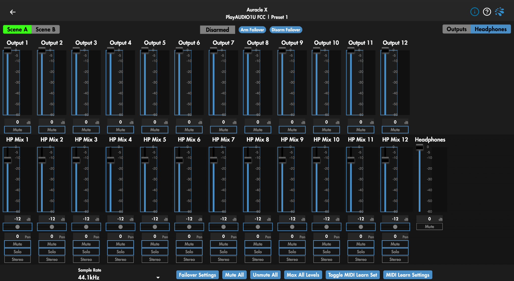

On the Audio page on the PlayAUDIO1U Auracle X menu, use the Toggle MIDI Learn Set button to turn on the MIDI Learn function in order to map CC messages to available parameters.

1. Plug in a MIDI controller capable of sending CC messages into the USB HOST port of the PlayAUDIO1U.

2. Navigate to the Audio page for the PlayAUDIO1U or PlayAUDIO2U in Auracle X. 

3. Click the Toggle MIDI Learn Set button to outline available parameters to be mapped. MIDI CC mappable fields will become outlined in blue.

4. Click the field of the object you wish to MIDI map. The object will slowly glow in blue.

5. Engage the knob or fader on your MIDI controller that you wish to map to the object field from the step above until the field of that object is steadily highlighted in blue.

6. Repeat for more MIDI mapping, or click Toggle MIDI Learn Set again to turn off the MIDI learn function and return to normal operation.

#### Deleting or Editing MIDI Learn settings

Click the MIDI Learn Settings button to see the list of active MIDI mapped parameters.

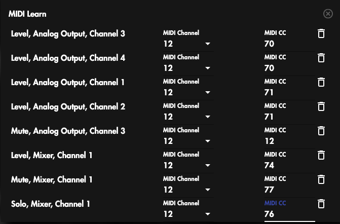

To delete an active MIDI mapping click the trash icon located in the far right of each MIDI map row.

To edit an active MIDI mapping, click the MIDI Channel dropdown or the MIDI CC value field of the mapping you would like to edit.

--- 

## MIDI Routing

### General Info

Different iConnectivity interfaces have differing numbers of MIDI port types and amounts but they can all be configured using our Auracle X software MIDI Routing page. The number and types of MIDI port sources and destinations will depend on the interface type you are using but every MIDI port includes its own 16 MIDI channels (1-16). These can be used to send and receive SysEx/MIDI data to and from any other port.

#### MIDI Ports & Channels

MIDI information in the iConnectivity ecosystem is organized according to three layers of separation: physical ports, virtual ports, and channels.

#### Physical MIDI ports

The four types of ***physical*** ports our devices may include are listed below:

| Physical MIDI Port Types | |
| :---- | :---- |
| **DIN MIDI Port** | The classic 5-pin MIDI DIN port |
| **USB Host Port** | USB A port used for connecting USB MIDI controllers |
| **USB DAW Port**| USB B or USB C port used for connecting USB devices eg PCs and tablets |
| **RTP MIDI Port** | RJ45 port for connecting CAT5e or better ethernet cables |
| | |

#### Virtual MIDI Ports

The USB Host, USB DAW, and RTP MIDI ports of iConnectivity interfaces are single physical ports that encapsulate multiple virtual MIDI ports. 

The DIN MIDI ports are 1-to-1; each physical DIN MIDI port corresponds to the identically named DIN MIDI port in the DIN MIDI port groups listed in Auracle X.

The mioXL for example has eight DIN MIDI input- and 12 DIN MIDI output- ports as listed in the MIDI routing page of Auracle X. 

The single **USB DAW** port however houses sixteen virtual ports in the its MIDI port group as you can see most clearly in the Output:USB DAW MIDI port group column 

The image below shows the mioXL MIDI routing page with sixteen virtual ports encapsulated within the physical USB DAW port, as well as ten virtual host ports on the physical USB Host port. To gain access to additional USB Host ports on our audio and MIDI interfaces you will need a powered USB hub, purchased separately.  

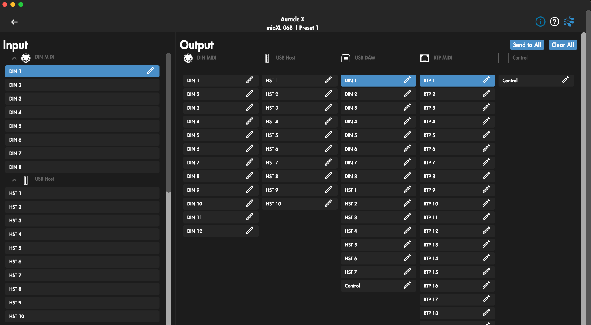

#### MIDI Channels

MIDI information is further separated by MIDI channels. Separating MIDI information by MIDI channels is useful for keeping MIDI intended for separate destinations separate from each other when using the same virtual MIDI port. MIDI channel separation can either be handled by assigning MIDI channels per device through that devicesʻ MIDI menu, or by using the MIDI Remap function detailed later in this manual.  

---

### How To Route MIDI

Navigate to the MIDI Routing page. On the left side of the page in the Input column select the physical (DIN MIDI) or virtual port you wish to route. The Input port becomes highlighted in blue and the Output field to the right populates with all available routing destinations for the selected source port.

Select the Output port you wish to route your selected MIDI input to.

Thatʻs it.

Depending on the interface, most MIDI Inputs will be routed to one MIDI Output when first connected or Factory reset, representing what we think is a great starting point. Please keep in mind that you will likely need to continue routing MIDI in your DAW to complete the MIDI path between devices.

You may also find it helpful to rename MIDI Input and/or Output ports to something more meaningful for your personal use case. 

To rename MIDI ports click the pencil icon and enter your personalized port name into the name field and click save when done.

---

### The MIDI Control Port

Send a program change message to the MIDI control port on MIDI Channel 1 to change interface presets.

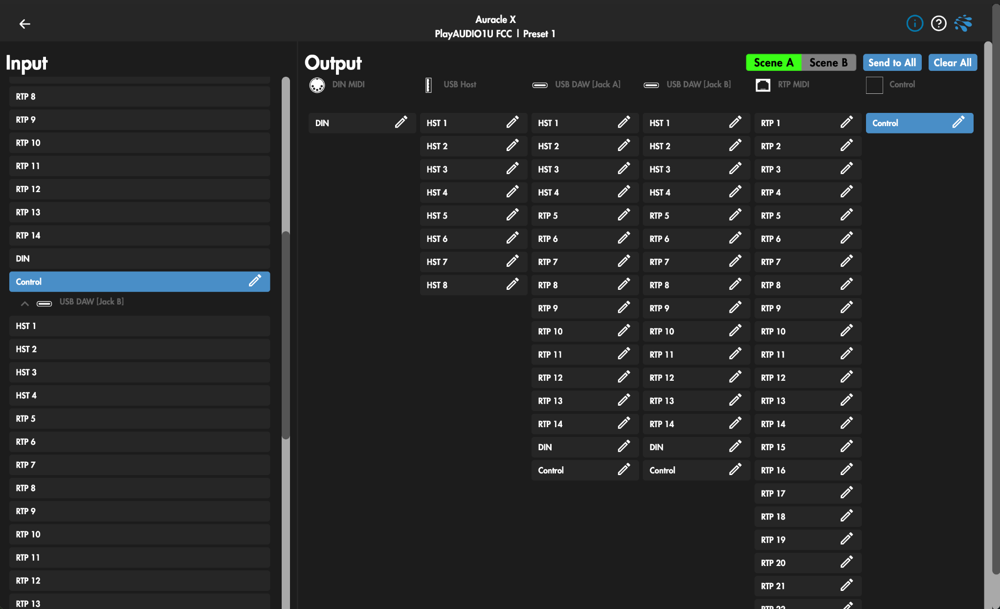

The MIDI Control port found on our X-Series MIDI interfaces as well as our PlayAUDIO1U, PlayAUDIO2U, and PlayAUDIO2D can be used to trigger interface preset changes from your DAW or another MIDI device that can send program change messages.

To use this function, simply route a program change message on MIDI channel 1 from your program change source to the Control port as seen above.

In the example above, the MIDI Input port labelled “Control” in the USB DAW section to the left of the Auracle X menu is routed to the MIDI Output port labelled Control. When a MIDI track routed to the Control port is created in your DAW and a program change message is sent on MIDI channel 1, your connected interface will change programs to the program number sent. Additionally, a program change message can originate from any input port and will be effective if routed to the MIDI Control Output port.

Please note that MIDI control port enabled interfaces of ours have varying available programs. You should also note that in order to send program change messages to the interface from any preset, *all* presets must have MIDI control port routing enabled.

## Filter & Remap

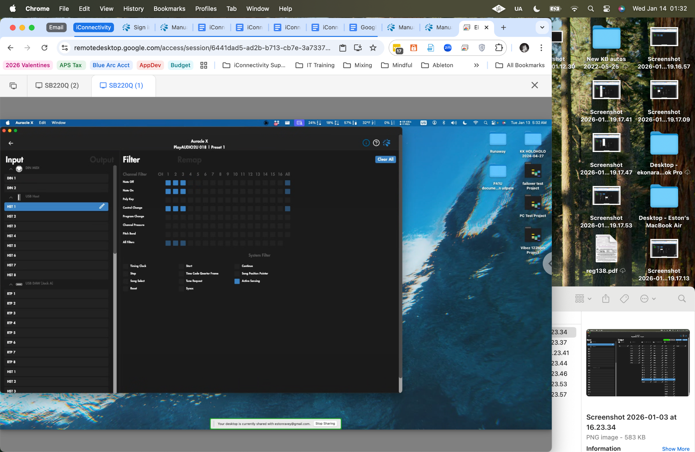

Each MIDI port can be remapped or filtered based on channel or data types (ie Note, Control Change, Pitch Bend, etc). Like the MIDI Routing page, you must first select an Input port for the Filter and Remap options to populate in the field the the left. Note that Output is also selectable to the right of input to filter or remap MIDI data at the Output port. 

Check out [this video](https://www.iconnectivity.com/auracle-x-filter-remap) for help with the Filter & Remap section of iConnectivity devices.

### Input/Output

Selects whether to modify the input to the interface or the output from the interface. The terms referenced are from the interface’s point of view.

### Filter

Disable MIDI data type per port and channel channel by selecting the appropriate port on the left column, and by clicking the clickable square at the intersection of the desired MIDI channel (column) and data type (row).

To filter all channels of a MIDI data type (for example, all Note On/Off messages) you may select the clickable square in the column marked All to the far right of the grid of clickable squares.  
---

### Remap

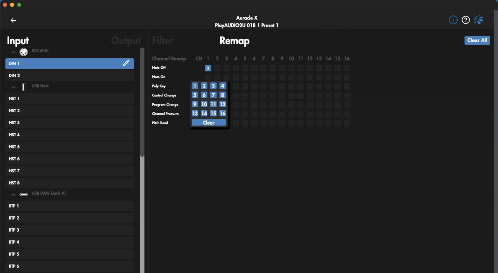

Remapping allows you to change the channel path of MIDI information per port and channel by remapping incoming and outgoing MIDI messages to another MIDI channel of your choosing.

To remap MIDI information appearing at an iConnectivity interface MIDI input:

1. Select the Input menu item  
2. Select the Input MIDI port to remap  
3. In the Remap field, click the data type that needs to be remapped. A menu will appear allowing you to choose a MIDI channel to remap the selected MIDI data type to. You can repeat for as many MIDI data types and channels as you need to.

To remap MIDI information appearing at an iConnectivity interface MIDI output:

4. Select the Output menu item  
5. Select the Output MIDI port to remap  
6. In the Remap field, click the data type that needs to be remapped. A menu will appear allowing you to choose a MIDI channel to remap the selected MIDI data type to. You can repeat for as many MIDI data types and channels as you need to.

#### Clear All

Clear the current configuration.

#### Back button

Select to return to the main menu.  

---

## Presets

### Interfaces with multiple presets

If your interface supports multiple preset save and load, you will be presented with the option to save your current settings in one of many preset slots, or to save a single setting across all presets.	

Saving to a preset is as simple as clicking the **Save Preset As** dropdown menu and selecting the preset slot(s). You will be presented with the option to give your preset a custom name before clicking **Save** to commit settings to memory or **Cancel** to abort saving.

To Load a preset, click the **Load Preset** dropdown button and select the preset you wish to load.

---

### Interfaces with single presets

If your interface supports only a single preset the Presets page of Auracle X will present you with only two options: save the current settings to memory or load the last save settings to memory.

> **Note:** To save current settings on the PlayaUDIO12 tap the rotary encoder on the front panel of the unit. All cap touch buttons will flash amber to indicate that settings at the preset level have been saved

### **Backup / Restore**

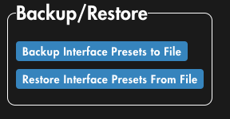

Our Backup and Restore feature allows you to backup and recall single or all presets to file for archiving.

#### Backup

1. With your interface plugged in to your computer navigate to the Presets page of the device whose presets you wish to save.  
2. Click the Backup Interface Presets to File button.  
3. Choose the file path and name in your systemʻs file manager and click save.

#### Restore

1. With your interface plugged in to your computer navigate to the Presets page of the device whose presets you wish to restore.  
2. Click the Restore Interface Presets From File button.  
3. Choose the preset file from your systemʻs file manager and click Open.

> **Note:**  restoring a preset restores the saved preset from file to the preset slot it was saved from. It is necessary to then load the preset using the Load Preset option.

## RTP / Network MIDI

RTP / Network MIDI is a great and useful solution for applications where MIDI information needs to travel long distances between a network including RTP enabled iConnectivity MIDI interfaces and/or computers.

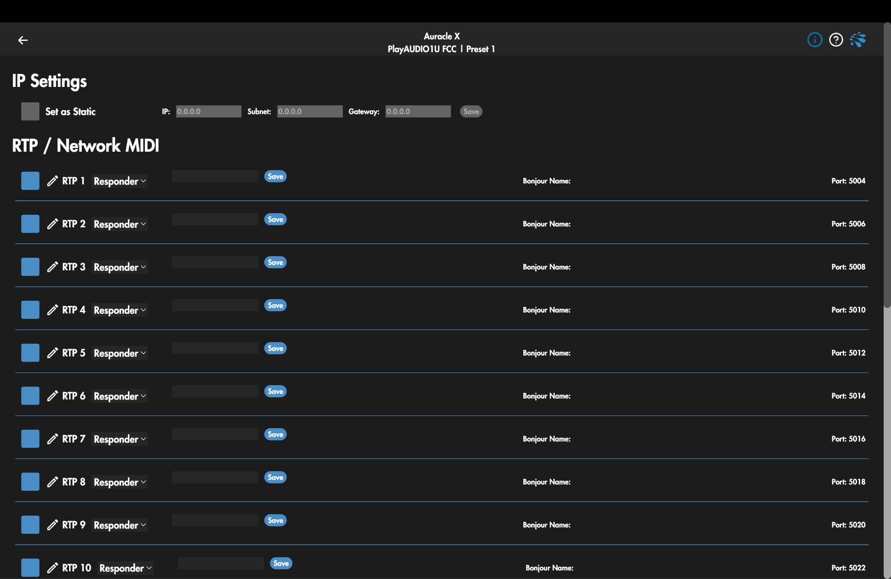 

While it is helpful to have some knowledge of computer networking, it is not absolutely necessary for building and maintaining RTP MIDI networks.

For advice on how to setup an RTP network please check out this [instructional video](https://www.youtube.com/watch?v=i3ywIA2wCpI&t=697s).

### 

### **RTP / Network MIDI Menu**

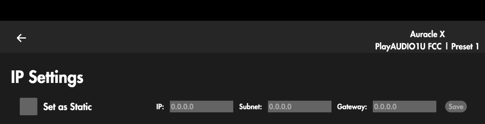

| IP Settings |  |
| :---- | :---- |
| **Set as Static** | Click to manually assign an IP address to your interface. Ethernet connection to the interface must be disconnected and reconnected to save static settings. |
| **IP** | Enter a custom IP address if Set as Static is selected, or displays the interface’s IP address if Set as Static is not selected and the interface is connected to a network via ethernet. |
| **Subnet** | Enter a custom subnet if Set as Static is selected, or displays the interface’s subnet  if Set as Static is not selected. |
| **Gateway** | Enter a custom gateway address if **Set as Static** is selected, or displays the interface’s gateway if Set as Static is not selected. |
| **Save** | Click to save the current IP settings. The ethernet cable connected to the interface you are configuring needs to be removed and reinserted to apply edited values in the Set as Static, IP, Subnet, and Gateway. |
| | |

| RTP / Network MIDI |  |
| :---- | :---- |
| **Session active button** | Click blue to make the session available for configuring and click gray to disable. |
| **Pencil icon** | Click to edit the name of the virtual MIDI port. |
| **RTP virtual port label** | Displays the name of the virtual RTP session. |
| | |

| Initiator / Responder |  |
| :---- | :---- |
| **Initiator** | Select Initiator to allow the virtual RTP port to initiate an RTP session. RTP sessions must always have one initiator and one responder. |
| **IP** | Enter the address of the Responding RTP session when connecting using IP address. |
| **Port** | Enter the port of the Responding RTP session when connecting using an IP address. The port number of an RTP session can be found on the far right of each row. |
| **Name field** | Enter the bonjour name of the Responding RTP session when using Name. |
| **Responder** | Select Responder to open the virtual RTP port to session Initiator requests. |
| **Bonjour Name**  | Enter the Bonjour name of the RTP session in this field. |
| | |

## **MIDI Processing**

The latest version of Auracle X introduces a new MIDI Processing section for more granular MIDI control.

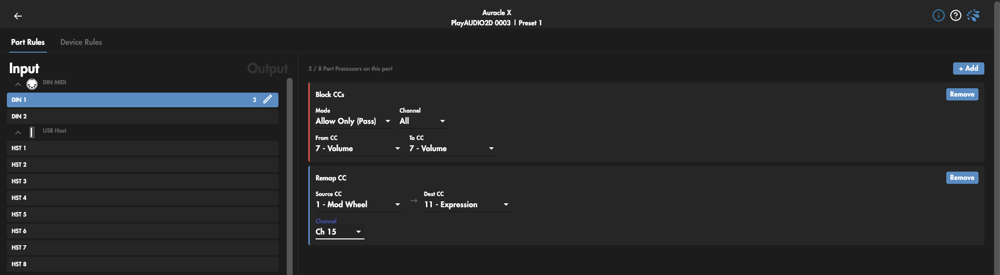

### Transpose Notes

Shifts Note On/Off numbers by −48…+48 semitones. LUT-based, clamped at 0 and 127 (so extreme transposes flatten at the ends rather than wrapping). Set Semitones, optionally restrict Channel, pick targets.

### Mirror Notes

Reflects notes around a *Pivot Note*: note n becomes 2×pivot − n. Playing up the keyboard sounds like playing down. Pivot default C4/60. Fun for practice and for inverted-keyboard rigs.

### Drum Mapper

Arbitrary note→note remap. Click \+ Add note remap and pick a from/to pair (dropdowns show names like D\#1 (27)). Anything you don't list passes through unchanged, so you only enter the pads you actually need to move. This is the tool for reconciling a pad controller with a drum instrument's layout.

### Scale Quantizer

Snaps every incoming note to the chosen *Root* \+ *Scale*. Fourteen scales from Major/Minor through the modes, Blues, and Whole Tone. Implementation snaps downward to the nearest scale tone at or below the played note, so out-of-key notes always fall to the degree below, never above.

### Velocity Curve

Reshapes Note On velocity through one of six presets: Linear, Soft (√x — makes light playing louder), Hard (x² — needs harder hitting), Logarithmic, Exponential, S-Curve (cosine ease). Only affects Note On.

### Fixed Velocity

Forces every Note On to a constant 1–127. For non-velocity-sensitive controllers, organ/clav parts, or programming hi-hats at a uniform level.

### Velocity → Channel

Velocity-layer splitting. Set a *Threshold*; hits at or above it go to the *Hard hits* channel, below it to *Soft hits*. Note Offs are echoed to both destination channels, so notes always release regardless of which layer triggered them (the device is stateless, so this is deliberate — expect two Note Offs per note downstream, which is harmless for nearly every synth).

### Channel Remap

Collapses traffic onto one channel. *From* is the source filter (All or one channel), *To Channel* is the single destination. Applies to all channel-voice message types, not just notes.

### Keyboard Split

2 to 8 contiguous note zones, each routed to its own channel. Each zone row is low note … high note → channel; \+ Add Zone appends one (defaulting to the top of the keyboard) and ✕ removes one (minimum 2). Non-Note messages on the source channel pass through untouched, so sustain and mod wheel don't get trapped in a zone. Zones aren't validated for overlap or gaps — order and coverage are on you.

### Remap Message

Converts one MIDI event type into another (e.g. Channel Pressure → Control Change). Pick *Source Type* and *Dest Type* from the 7 channel-voice types. The orchestrator handles the 2-byte/3-byte mismatch automatically when you cross between types like Program Change and CC.

### Scale Values

Rescales CC values. Give an *Input Range* (min/max) and an *Output Range* (min/max); values outside the input range are clamped. Use it to limit an expression pedal's travel, or invert a control by setting output min \> max. Applies to Control Change only.

### Event Filter

The simplest gate. Pick an *Event Type* and either "Block this type" or "Pass only this type". Default is blocking Poly Aftertouch, which is the common case (keyboards that spray aftertouch at synths that choke on it).

### Value Range Filter

The precise gate. Pick *Event Type*, then whether you're filtering on byte 2 (note\# / CC\#) or byte 3 (the value), then a Min/Max window and an action:

* *Pass only matching*— events inside the window survive, everything else of that type is dropped.  
* *Block matching*— events inside the window are dropped, everything else passes.

Filtering byte 2 on Control Change is how you block a range of CC numbers; filtering byte 3 on Note On is how you drop ghost-quiet velocities.

### Pitch Bend Dead Zone

Snaps pitch bend MSB values within ±*width* of center (64) back to exactly 64, leaving the rest of the throw untouched. Width 0–32. This kills wheel jitter/off-center rest position without compressing the bend range. Width 4 is the default and is usually enough.

### Chord Generator

Each input note produces N notes at fixed semitone offsets. Presets cover Major/Minor/Diminished/Augmented triads, Maj7/Dom7/Min7, Octaves, Power Chord. The number of intervals is fixed when you create the rule (it determines how many operator and LUT slots got reserved) — the default is 3 tones, so only 3-note presets appear in the Preset dropdown. You can freely edit each interval value (−24…+24); to get a 4-note chord you must remove the rule and re-add it.

## USB Host Reservation

USB Host Reservation is a useful tool to ensure that your USB MIDI controllers always populate the same virtual USB Host Port when they’re plugged into your interface, especially if you use multiple USB MIDI controllers.

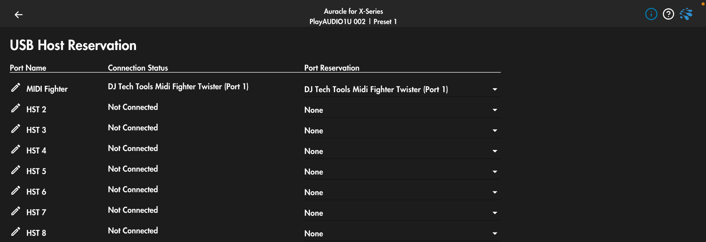

|USB Host Reservation Menu| |
| --- | --- |
| **Pencil Icon** | Click to edit the virtual host port name. |
| **Port Name** | The name of the virtual MIDI port. |
| **Connection Status** | Displays “Not Connected” unless connected to a USB Host device. |
| **Port Reservation** | Displays the currently reserved USB Host device, or “non” if no reservation has been made. |
| | |

### **Making USB Host Reservations:**

1. With your class compliant USB Host device plugged in, open the Auracle X software and navigate to the USB Host Reservation page.  
2. Choose the USB Host port you wish to reserve and find the plugged in deviceʻs device ID in the dropdown menu on the same USB  Host port.  
3. Navigate to the Presets page and save your settings before unplugging or power cycling

----

> Notes on USB MIDI controllers and iConnectivity Interfaces:  
> iConnectivity interfaces allow USB MIDI controllers to be connected via dedicated USB Host ports. The USB-A MIDI host port(s) have 2 main guidelines: 
>1. USB Host devices must be USB class compliant \- No drivers required for functionality. 
>2. USB Host ports will only pass SysEx/MIDI data.  
> Each iConnectivity interface that has a USB Host port(s) has limits regarding power consumption by connected USB MIDI devices as well as number of available virtual MIDI ports to populate  
>Please consult the documentation for your specific interface regarding power availability for individual as well as cumulative power available to USB Host port  
>If your device requires more power than is available according to the power specifications of your interface, you will need to power your USB MIDI device with an external power supply.  
>When using multiple MIDI devices this way, use the USB Host Reservation menu to assign static host ports for your MIDI devices so they retain their host port assignment between power cycles and/or unplugging and replugging USB Host devices  
> You can connect a powered USB hub to any of our host ports to add more controllers but there will still be a limit for each interface that doesn’t change.  
>A maximum of eight controllers are supported for the following interfaces: PlayAUDIO2D, PlayAUDIO2U, >PlauAUDIO1U, PlayAUDIO12, AUDIO4+, AUDIO4c, MIDI4+, mio4, mioXM.  
A maximum of 10 controllers are supported  for the following interfaces: mio10, mioXL.

---

## Control Ports

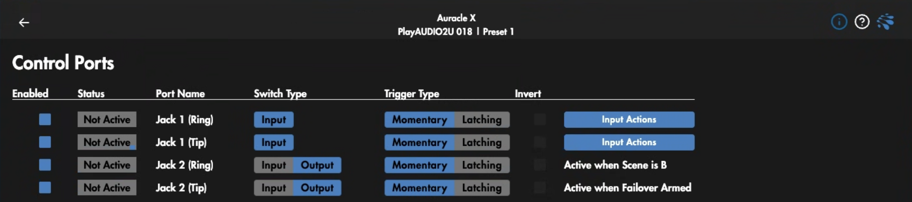

All PlayAUDIO interfaces are equipped with ¼” control ports.

### PlayAUDIO12

On the PlayAUDIO12, the control ports are marked In and Out and can be connected with a ¼” TRS cable to daisy-chain multiple PlayAUDIO12 units together in an aggregate device to ensure simultaneous failover switching among multiple devices. There is no menu page for the control ports on the PlayAUDIO12. 

To activate synchronous failover between two PlayAUDIO12s, connect the primary PlayAUDIO12 Out port to the secondary PlayAUDIO12 In port using a ¼” TRS cable.

The Control In port on the PlayAUDIO12 can also be used with a footswitch such as the Boss FS-6 to toggle between scenes A and B. Use a ¼” TRS cable to connect the In control port of the PlayAUDIO12 to the “A & B” port of the Boss FS-6 to manually switch active scenes.

---

### PlayAUDIO2D, PlayAUDIO2U, PlayAUDIO1U

The control ports on the PlayAUDIO2D, PlayAUDIO2U PlayAUDIO1U can be configured to send MIDI CC or program change messages, as well as perform failover functions as listed below. The control ports can also be disabled by clicking the blue box in the **Enabled** column on the far left of the Control Ports menu page.

| Control Ports Menu | |
| :---- | :---- |
| **Enabled** | Enables the assigned control port. |
| **Status** | Lights up green when a connected and compatible control switch is actuated regardless of enabled status. |
| **Port Name** | Identifies the control switch by jack and number and type (Tip or Ring). |
| **Switch Type** | Select input or output; input receives the switch actuation, output sends a selected control action. |
| **Trigger Type** | Chooses between Momentary and Toggle switching. |
| **Invert** | Check to invert the polarity of the control switch. |
| **Actions** | *See Control Ports [Actions Page](#control-ports-action-page) below.* |
| | |

### Control Ports Action Page

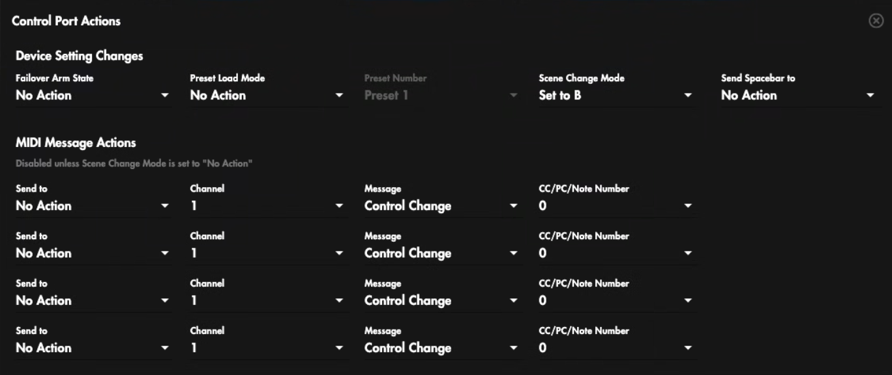

#### Device Settings Changes

| Failover Arm State | |
| :---- | :---- |
| **No Action** | No action is taken on Failover Arm State. |
| **Arm** | Arms automatic failover detection if automatic failover detection is disarmed and a MIDI or Audio signal detection condition is met. |
| **Disarm** | Disarms automatic failover detection if automatic failover detection is armed and a MIDI or Audio signal detection condition is met. |
| **Toggle** | Toggles the automatic failover detection between armed and disarmed if a MIDI or Audio signal condition is met. |
| | |

| Preset Load Mode | |
| :---- | :---- |
| **No Action** | Activating the control switch takes no action on presets. |
| **Select**	 | The preset selected in the Preset Number dropdown menu is called. |
| | |

| Send Spacebar | |
| :---- | :---- |
| **Send To Host A **| Activating the control switch sends spacebar character to USB DAW port A |
| **Send To Host B** | Activating the control switch sends spacebar character to USB DAW port B |
| **Send To Both Hosts** | Activating the control switch sends spacebar character to both USB DAW ports A and B |
| | |

##### Preset Number

Chooses between Preset 1-Preset 16 to select the preset to recall when Preset Load Mode is on Select and the control is activated

| Scene Change Mode | |
| :---- | :---- |
| **No Action** | Activating the control switch takes no action on scene selection. |
| **Toggle** | Activating the control toggles between Scene A and Scene B. Depending on the polarity of your switch, toggle action will be initiated either when the control is activated or when it is released. |

---

#### MIDI Message Actions

In addition to failover arm, preset, and scene change messages, the PlayAUDIO1U control ports can be   
configured to send a MIDI control change or program change number when activated.

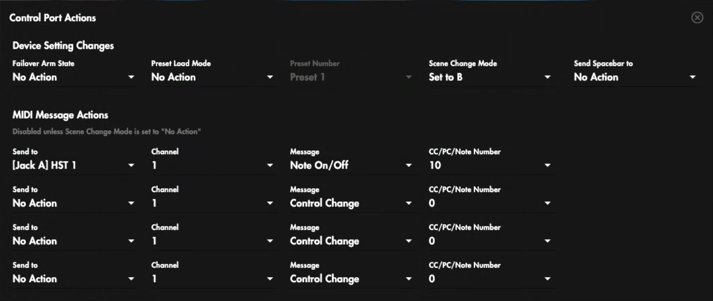

| MIDI Message Actions | |
| :---- | :---- |
| **Send to** | Selects the port to send a MIDI message on control activation . |
| **Channel** | Selects a MIDI message action channel: 1-16. |
| **Message** | Selects Control Change or Program change as the type of message sent. |
| **CC or PC Number** | Select control change or program change number 0-127. |
| | |

## **Control Buttons**

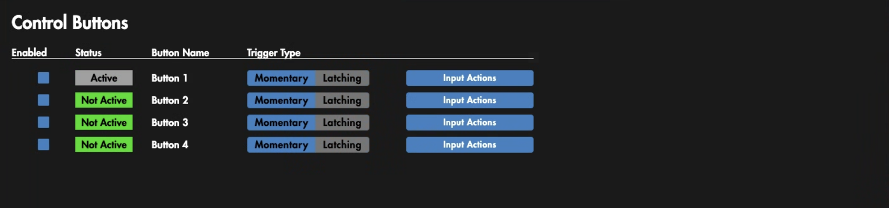

The PlayAUDIO2D and PlayAUDIO2U are equipped with four front panel user assignable control buttons. These buttons have MIDI assignment capabilities identical to the Control Port Device Setting change and MIDI Message Actions described above.

The control buttons can also be disabled by clicking the blue box in the **Enabled** column on the far left of the Control Buttons menu page.  

---

# **Updating Firmware**

## **Load Latest From Web**

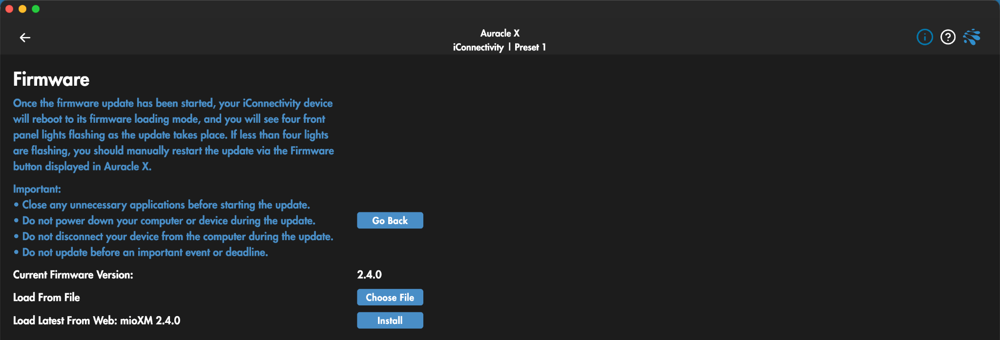

To use Auracle X to update your device’s firmware:

1. Ensure your computer is connected to the internet.  
2. Connect your interface to your computer via USB.  
3. Open the Auracle X application.  
4. On the interface’s main menu tab, click the **Firmware** menu option.  
5. If newer firmware for your device is available, a menu option to update firmware will appear in the **Load Latest From Web** section. Click **Install** to update from the web. 

## **Load From File**

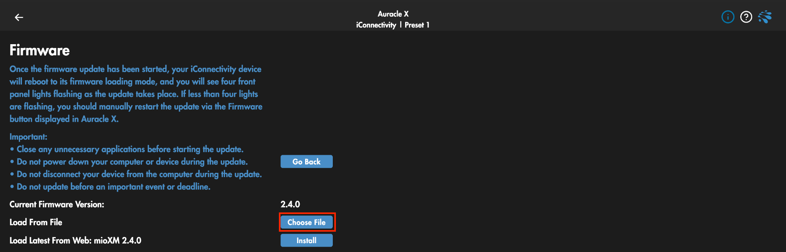

The latest firmware for your device is also available for manual download at: [https\://www\.iconnectivity.com/firmware](https://www.iconnectivity.com/firmware) 

1. Connect the interface to your computer via USB.
2. Open the Auracle X application.  
3. Click **Firmware** on the interface’s main menu tab.  
4. In the **Load From File** section, click **Choose File** to call your system file browser and select a firmware file for update.

---

# **APPENDIX A: MORE RESOURCES**

[**iConnectivity Website**](https://www.iconnectivity.com/)

[**iConnectivity Support Headquarters and Knowledge Base**](https://iconnectivitysupport.zendesk.com/hc/en-us)

[**iConnectivity interfaces Unified Windows Driver**](https://www.iconnectivity.com/windows-drivers)

[**Auracle X Interface Configuration Software**](https://www.iconnectivity.com/auracle-x-series) page.

[**Interface Firwmware updates**](https://www.iconnectivity.com/firmware).

[**iConnectivity Warranty Policy**](http://www.iconnectivity.com/warranty).

Product Features, Specifications, and System Requirements may be subject to change.

Mac, macOS, OS X, and iOS are trademarks of Apple Inc., registered in the United States and/or other countries.

Windows is a registered trademark of Microsoft Corporation in the United States and/or other countries. 

Android is a trademark of Google LLC.

iConnectivity, PlayAUDIO2D, PlayAUDIO2U, PlauAUDIO1U, PlayAUDIO12, AUDIO4+, AUDIO4c, MIDI4+, mio4, mioXM, and mioXL are trademarks of iKingdom Corp. Features of this product are protected under patent pending. 

For more details see [iConnectivity Patents](http://www.iConnectivity.com/patents). 

© iKingdom Corp. 2026

---