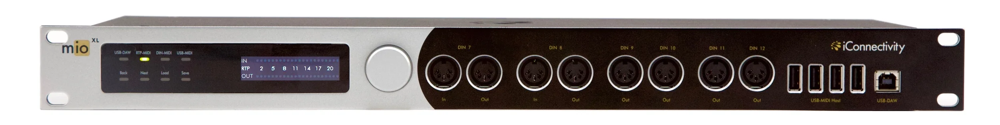
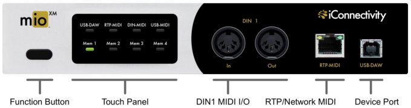
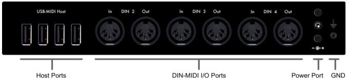
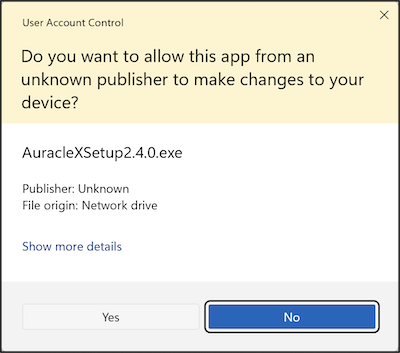
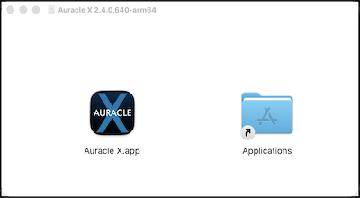
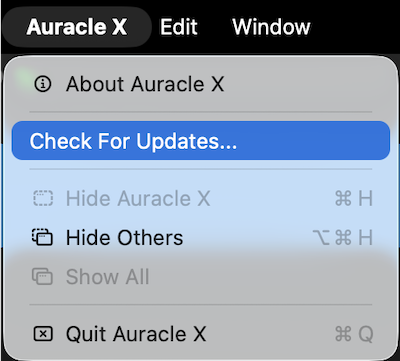
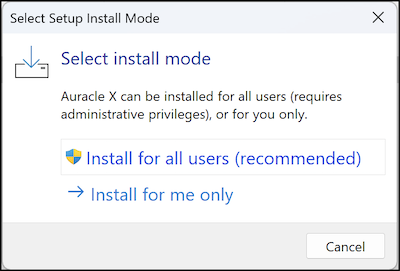

# mio X Series User Guide

## Introduction

Congratulations on the purchase of your new mio X Series MIDI interface!

- Auracle X software (Mac OS, Windows) configuration and setup
- High-resolution audio - up to 24-bit/96kHz AD/DA conversion
- High definition OLED display and Capacitive touch user controls
- Endless multifunction rotary encoders
- 19” rack mountable

### Feature List

**mioXM**
- DIN-MIDI ports built-in (4-in, 4-out)
- USB Host ports (4 avaialbe on-board; connect up to 8 USB MIDI class-compliant devices with a USB hub)
- USB-DAW port supporting mac and Windows connectivity
- Ethernet RTP-MIDI Network port
- Capacitive touch control panel
- Four recallable custom preset slots
- Auracle X software (Mac OS, Windows) configuration and setup

**mioXL**
- DIN-MIDI ports built-in (8-in, 12-out)
- USB Host ports - 10 avaialbe on-board
- USB-DAW port supporting mac and Windows connectivity
- Ethernet RTP-MIDI Network port
- OLED display with rotary encoder
- Capacitive touch control panel
- Sixteen recallable custom preset slots
- Auracle X software (Mac OS, Windows) configuration and setup

### What's in the Box

- mio X-Series Interface
- Universal Power Adapter: 100V - 240V AC, 50/60 Hz
- USB Cable: Type-A to Type-B
- Ethernet Network Cable
- Optional Rubber Feet (mioXL only, quantity 4)

### Minimum System Requirements
- macOS - macOS 12 or later (for Auracle X control software), One free USB port

- PC/Windows - Windows 10 or later (for Auracle X control software), One free USB port

- iOS - Device must be equipped with a USB-C port and CoreMIDI compatible app

- Android - Android 8.0 or higher with USB-C connector

## Hardware Description

### mioXM Front Panel

- **Function button.** Short press to power on. Long press until all LEDs are off to power off. Long press and release when LEDs turn red to enter bootloader mode.
- **Touch Panel**. Recall user memory or inspect real time MIDI and audio information
- **MIDI DIN ports.** 5 pin DIN connections for MIDI controllers, modules, etc.
- **RTP MIDI PORT.** Make long distance MIDI connections over ethernet.
- **Device Port.** USB B port for connecting computers or tablets.

### miOXM Rear Panel

- **USB Host Ports.** Connect four USB MIDI class-compliant devices directly or up to 8 USB MIDI class-compliant devices with a USB hub
- **MIDI DIN ports.** 5 pin DIN connections for MIDI controllers, modules, etc.
- **Power Port.** Plug in provided power adapter.
- **GND.** Connect the mioX chassis GND to other GND conections in your system if necessary.

---

### mioXL Front Panel

- **Touch Panel.** Recall user memory or inspect real time MIDI and audio information
- **OLED Dispaly.** Inspect realtime interface and MIDI monitoring information
- **Rotary Encoder.** Multi-function encoder. Turn to navigate through menu options and press to enter. Long press to call power off countdown.
- **MIDI DIN ports.** 5 pin DIN connections for MIDI controllers, modules, etc.
- **USB Host Ports.** Connect USB MIDI class-compliant devices.
- **Device Port.** USB B port for connecting computers or tablets.

### miOXL Rear Panel

- **GND.** Connect the mioX chassis GND to other GND conections in your system if necessary.
- **RTP MIDI PORT.** Make long distance MIDI connections over ethernet.
- **USB Host Ports.** Connect USB MIDI class-compliant devices.
- **MIDI DIN ports.** 5 pin DIN connections for MIDI controllers, modules, etc.
- **Power Port.** Plug in provided power adapter.

## Getting Started
### Mac Users
There are no software drivers to download or install; the mio X Series interface uses the USB MIDI class-compliant drivers built into macOS.

### Windows - Install iConnectivity Audio Drivers
Before connecting the mio X Series to a Windows computer please download and install the latest version of our Unified Windows Driver at https://www.iconnectivity.com/windows-drivers.

You may also download the unified USB driver separate from Auracle X at https://www.iconnectivity.com/windows-drivers.

Connect your computer to your mio X Series USB DAW Port A using a USB 2.0 or better data cable.

The interface should appear as a standard audio output device in Windows. You can route audio from music or video apps directly to the interface to test.

### Auracle X configuration software from iConnectivity
Quick and simple configuration of the mio X Series is possible via onboard controls but deep customization is available via our Auracle X application.

Read on in the Auracle X section below for more information.

> **Note:** All analog output volumes including the headphones output are muted by default and need to be raised for monitoring.

## Recommended Software Installation
### Windows - Install iConnectivity RTP MIDI Driver for Network MIDI

The RTP-MIDI driver for Network MIDI can be found at https://www.iconnectivity.com/windows-drivers

Apple Bonjour Print Services for Windows is also required for RTP session discovery over network via bonjour and is available at:
https://support.apple.com/en-us/106380

Launch the rtpMIDISetup Application and follow all prompts to install.

### MIDI Monitoring tools
MIDI monitoring applications are very useful for routing debugging and troubleshooting. We recommend these free tools for your operating system:

Windows: [MIDI-OX](http://www.midiox.com/)

MacOS: [Snoize MIDI monitor and Sysex Librarian](http://www.midiox.com/)

> **Note:** After installing the RTP-MIDI driver and Apple Bonjour Print Services be sure to restart your computer in order for the RTP-MIDI driver to default to using Apple Bonjour instead of lightweight mDNS for RTP session discovery

## Installing Auracle X
Before you begin using your mio X Series we recommend that you upgrade your unit's firmware to the latest version using iConnectivity's Auracle X application.

Download the latest version of the Auracle X software installer at: https://www.iconnectivity.com/software/control-software

### Mac Users
## First time Installation

When the Auracle X application has finished downloading open the .dmg file

Drag the Auracle X application to the Applications folder.

### Mac Users: Auracle X update

If you already have the Auracle X application installed, use the Auracle X main menu to check for updates and follow the prompts that follow if a newer version of Auracle X is available.

### Windows Users
**First time installation**

When the package installer download is complete, run the Auracle X installer.

Click Yes to allow Auracle X Setup

Install for all users

## Updating mioX Series Firmware
### Load Latest From Web
To use Auracle X to update your device’s firmware:

1. Ensure your computer is connected to the internet.

2. Connect the mio X Series to your computer via the USB DAW A port on your mio X Series.

3. Open the Auracle X application.

4. On the mio X Series main menu tab click the Firmware menu option

5. If a newer firmware for your device is available a menu option to update firmware will appear in the Load Latest From Web section. Click Install to update from web

### Firmware Update: Load from file

The latest firmware for your device is  also available for manual download at: https://www.iconnectivity.com/firmware

1. Connect the mio X Series to your computer via the USB DAW A port on your mio X Series.

2. Open the Auracle X application.

3. Click Firmware on the mio X Series main menu tab.

4. In the Load From File section click Choose File to call your system file browser and select a firmware file for update.

### Bootloader Mode & Manual Firmware Update

Bootloader Mode is a special service mode used to perform firmware updates. It may be entered automatically (via iConnectivity software Auracle X) or manually (via a specific sequence of manual steps).

The preferred method for updating your device’s firmware is to use iConnectivity software. Our software can check if newer firmware is available and if so, download it into your device. The software method is automated and switches your device modes for you.

In rare situations, you may prefer to manually update your firmware using the bootloader. This will require several steps:

1. Download the firmware from the iConnectivity website Firmware Page

2. Manually set your mio X Series interface to Bootloader Mode by following the instructions here

3. Transmit the firmware file to the mio X Series and allow the update to complete

4. Manually restart your mio X Series by first powering off the device and then powering on again.

### Firmware File Format

iConnectivity firmware is formatted as a Standard MIDI File with a .MID file extension. That means that standard MIDI software such as DAWs, Standard MIDI File Players, and System Exclusive (a.k.a. “SysEx”) applications can be used to transmit the firmware data to your interface. Examples of software that we have tested and can recommend are:

- macOS: [Snoize SysEx Librarian](https://www.snoize.com/SysExLibrarian/)

- windows: [MIDI-OX](http://www.midiox.com/)

## Modes of Operation

iConnectivity interfaces have three modes of operation:

### Power Off
The interface is powered off and not operational.

### Application Mode
This is the normal operational mode that you will use nearly all of the time. In this mode, the device is powered on and operates as a fully functional interface.

### Bootloader Mode
Bootloader Mode is a special service mode used to perform firmware updates. Normally you will use Auracle X software to update your firmware and Auracle X will automatically switch your interface between Normal and Bootloader modes as necessary. In rare situations users may prefer to manually update their firmware via the bootloader. This manual process is described in detail in the [Updating Firmware](#updating-mio X Series-firmware) section of this guide.

To manually force your mio X Series into Bootloader mode:

**mioXM**
1. Power on your mio X Series and wait until the bootup process is complete.

2. Long press the function button until all mode buttons illuminate red, then immediately release the function button.

The mioXM will reboot and enter Bootloader mode ready to accept a manual firmware file send.

> **Note:** The mioXM is in Bootloader mode when the OLED display is blank and both the DIN-MIDI and USB-MIDI LEDs alternately flash green.

---

**mioXL**
1. Power off your mioXL by long pressing the rotary encoder until the powering off countdown completes.

2. Long press the rotary encoder until all mode buttons illuminate red, then immediately release the function button.

The mioXL will reboot and enter Bootloader mode ready to accept a manual firmware file send.

> **Note:** The mioXM is in Bootloader mode when the OLED display is blank and both the DIN-MIDI and USB-MIDI LEDs alternately flash green.

## Controls

### Function button

| Function  | Action    |
| ---       | ---       |
| Power On  | Short press |
| Power Off | Long press until all LEDs are turned off then immediately release |
| Bootloader Mode | From power off state, long press until all LEDs illuminate red then immediately release |
| | |

### Using the Touch Panel and Main Rotary Encoder and Bottom Row Controls

The interactive Touch Panel on the front of the mioXM controls several functions of the
interface and displays status on eight LEDs. 

#### Top Row LEDs

The top row LEDs illuminate whenever there is activity on any of the I/O ports:
- USB-DAW  - USB MIDI between mioX and your computer; double tap to send a MIDI panic message 
- RTP-MIDI - RTP/Network MIDI
- DIN-MIDI - MIDI on DIN Ports
- USB-MIDI - MIDI on USB Host Ports

#### Top Row LED Color Legend
| Color | Meaning |
| --- | --- |
| Red | MIDI / Sysex information received on the flashing port |
| Green | MIDI / Sysex information sent from the flashing port |
| Amber | MIDI / Sysex information both sent and received on the flashing port |
| | |

#### Bottom Row Controls

The four bottom capacitive touch buttons correspond to onboard memory presets. After saving configuration changes to your mioXM or to your computer using the Auracle X applicaiton, touch a memory preset to instantly recall that preset.

#### Memory Preset Legend
| Color | Meaning |
| --- | --- |
| Red | The active memory preset has unsaved preset-level configuration changes |
| Green |The active memory preset has no unsaved preset-level configuration changes|
| | |

#### Global Mute

Global Mute mutes all rear analog outputs and preserves the headphone output.

Double tap the headphone encoder rapidly to engage Global Mute, muting all analog outputs of the mio X Series.

Double tap again while Global Mute is active to unmute.

Turn the encoder slowly to raise or lower the selected headphone mix volume in 0.5 dB increments.

## Specifications

### USB Host Ports Power Delivery

|  | Max Current per port | Total Current Per Unit |
| --- | --- | --- |
| mioXM | 500mA | 2000 mA |
| mioXL | 500mA | 3000 mA |
| | |

### Power Adapter
| | |
| --- | --- |
| Output | +12V DC, 3A (36W) |
| Input  | 100V - 240V AC, 50/60 Hz |
| Plug   | Center Pin Positive 2.5 mm inside diameter   5.5 mm outside diamter   1 2mm length |
| Model  | iCoonnectivity iCP4 |
| | |

### USB-C Ports
Connect to Windows or macOS computer(s), Android or iPadOS devices (USB only, Apple Lightning not supported)

### Power
- Input:    100V - 240V AC, 50 - 60 Hz 24W
- Fuse:     1A Slow-Blow

### Dimensions and Weights

**mioXM**
- Width:    8.43” (214 mm)
- Height:  	1.48” (37.5 mm)
- Depth:  	5.51” (140 mm)
- Weight:  	2.18 lbs (989 g) 

**mioXL**
- Width:    19” (483 mm)
- Height:  	1.75” (44.5 mm)
- Depth:  	4.72” (120 mm)
- Weight:  	4.02 lbs (1825 g) 

**Other**
- GND Screw: M3 x 0.5 x 6 mm, pan head, Phillips, black zinc

## APPENDIX A: More Resources

The **iConnectivity website** and **iConnectivity Knowledge Base** contain a wealth of helpful written articles and tutorials, as well as instructional videos. For your convenience, selected hyperlinks into these systems are listed below:

The **iConnectivity Knowledge Base** main page is located at: [iConnectivity Support Website.](https://iconnectivitysupport.zendesk.com/hc/en-us)

Download our latest Unified Windows Driver from the website [Windows Drivers](https://www.iconnectivity.com/windows-drivers) page.

Download **Auracle X** software from the website [Auracle X](https://www.iconnectivity.com/auracle-x-series) page.

Download the latest firmware from the website [Firmware](https://www.iconnectivity.com/firmware) page.

## APPENDIX B: Compliance

### Compliance Statement

The mio X Series meets the requirements of the following standards and directives:
- FCC Part 15 Class B
- CAN ICES-003 (B) / NMB-003 (B)
- CISPR 32 Class B
- EN61000-4-2 | ESD
- EN61000-4-3 | Radiated Immunity
- EN61000-4-4 | EFT
- EN61000-4-5 | Surge Immunity
- EN61000-4-6 | Conducted Immunity
- EN61000-4-8 | Magnetic Immunity
- EN61000-4-11 | VDI
- EN61000-3-2 | Harmonic
- EN61000-3-3 | Flicker
- IEC/EN-62368-1

### Declaration of Conformity

We, iConnectivity, declare that the mio X Series complies with Part 15 of the FCC Rules. Operation is subject to the following two conditions: (1) this device may not cause harmful interference, and (2) this device must accept any interference received, including interference that may cause undesired operation.

### Communication Statement
This equipment has been tested and found to comply with the limits for a Class B digital device, pursuant to Part 15 of the FCC Rules.

These limits are designed to provide reasonable protection against harmful interference in a residential installation. This equipment generates, uses and can radiate radio frequency energy and, if not installed and used in accordance with the instructions, may cause harmful interference to radio communications.

However, there is no guarantee that interference will not occur in a particular installation. If this equipment does cause harmful interference to radio or television reception, which can be determined by turning the equipment off and on, the user is encouraged to try to correct the interference by one or more of the following measures:

- Reorient or relocate the receiving antenna.
- Increase the separation between the equipment and receiver.
- Connect the equipment into an outlet on a circuit different from that to which the receiver is connected.
- Consult the dealer or an experienced radio/TV technician for help.

Changes or modifications not expressly approved by iConnectivity could void the user’s authority to operate the equipment.

### Disposal of Waste Equipment by Users in the European Union

*This product must not be disposed of with other waste. Instead, it is your responsibility to dispose of your waste equipment by handing it over to a designated collection point for the recycling of waste electrical and electronic equipment. The separate collection and recycling of your waste equipment at the time of disposal will help conserve natural resources and ensure that it is recycled in a manner that protects human health and the environment. For more information about where you can drop off your waste equipment for recycling, please contact your local city recycling office or the dealer from whom you purchased the product.*
