# PlayAUDIO1U User Guide

## Introduction
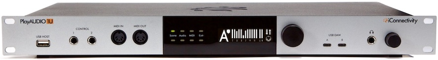

Congratulations on the purchase of your new PlayAUDIO1U USB Audio, MIDI & Dante interface!

### Feature List

- Two USB Type C DAW ports – use up to 2 computer devices Mac OS/Windows simultaneously
- Twelve  XLR analog audio Line Outputs 
- Stereo ¼” headphone output with two independent mixes (summable to one mix)
- DIN-MIDI ports built-in (1-in, 1-out)
- USB Host port (connect up to 8 USB MIDI class-compliant devices with a USB hub)
- Two MIDI mappable CONTROL footswitch ports
- Ethernet RTP-MIDI Network port 
- Auracle X software (Mac OS, Windows) configuration and setup
- High-resolution audio - up to 24-bit/96kHz AD/DA conversion
- High definition OLED display and Capacitive touch user controls
- Endless multifunction rotary encoders
- 19” rack mountable

### What's in the Box

- The PlayAUDIO1U Audio + MIDI Interface
- One IEC Power Cable - US / North American region 
- One IEC Power Cable - EU region 
- One IEC Power Cable - UK region
- Two USB Type C to Type C cables (black, white)
- One USB-Adapter: female USB-C to male USB-A
- Four Rubber feet  

### Minimum System Requirements
- macOS - macOS 12 or later (for Auracle X control software), One free USB port

- PC/Windows - Windows 10 or later (for Auracle X control software), One free USB port

- iOS - Device must be equipped with a USB-C port and CoreMIDI compatible app

- Android - Android 8.0 or higher with USB-C connector

## Hardware Description

### Front Panel

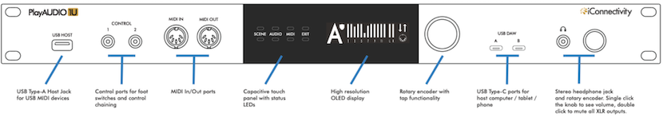

- USB Host port. Directly plug in a class-compliant MIDI device, or plug in up to eight class-compliant MIDI devices via a powered USB hub (not included).
- Control ports. Plug in up to two foot switches
- MIDI DIN ports. 5 pin DIN connections for MIDI Controllers
- Capacitive (cap) touch buttons & OLED. Manually switch scenes or inspect real time MIDI and audio information
- Rotary Encoder. Multi-function encoder. Double press to save current settings or spin to cycle through pages in the currently selected page 
- USB DAW ports. USB C ports for connecting computers or tablets.**
- 3.5mm Headphone port. Stereo mix
- Headphone Rotary Encoder. Multi-function encoder. Rotate to increase/decrease the headphone mix output volume; this also temporarily calls up the headphone volume display. Additionally: Double press to mute all rear outputs; double press again to unmute; press once to call the headphone volume display, and press again to return to the previous active menu. 

### Rear Panel

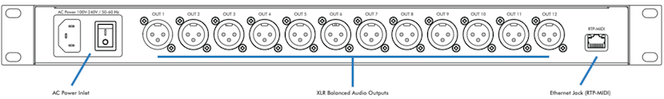

- AC Power inlet. Fused Input jack for included IEC C13 power supply cable.
- Power switch. Turn the PlayAUDIO1U on or off. The switch will illuminate when power is turned on. 
- XLR Balanced Audio Outputs. The PlayAUDIO1U's 12 analog outputs provide low noise, phantom power-resistant connections with up to 24-bit/96kHz DA conversion.
- RTP MIDI Port. Make long distance MIDI connections over ethernet.

## Getting Started
### Mac Users
There are no software drivers to download or install; the PlayAUDIO1U interface uses the USB MIDI class-compliant drivers built into macOS.

### Windows - Install iConnectivity Audio Drivers
Before connecting the PlayAUDIO1U to a Windows computer please download and install the latest version of our Unified Windows Driver at https://www.iconnectivity.com/windows-drivers.

You may also download the unified USB driver separate from Auracle X at https://www.iconnectivity.com/windows-drivers.

Connect your computer to your PlayAUDIO1U USB DAW Port A using a USB 2.0 or better data cable.

The interface should appear as a standard audio output device in Windows. You can route audio from music or video apps directly to the interface to test.

### Auracle X configuration software from iConnectivity
Quick and simple configuration of the PlayAUDIO1U is possible via onboard controls but deep customization is available via our Auracle X application.

Read on in the Auracle X section below for more information.

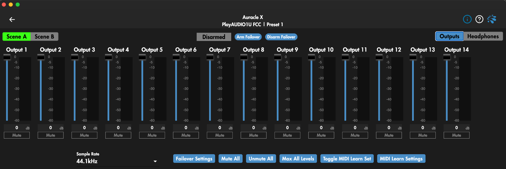

> **Note:** All analog output volumes including the headphones output are muted by default and need to be raised for monitoring.

## Recommended Software Installation
### Windows - Install iConnectivity RTP MIDI Driver for Network MIDI

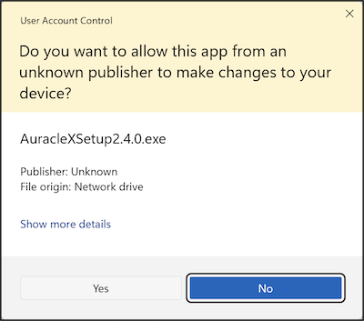

The RTP-MIDI driver for Network MIDI can be found at https://www.iconnectivity.com/windows-drivers

Apple Bonjour Print Services for Windows is also required for RTP session discovery over network via bonjour and is available at:
https://support.apple.com/en-us/106380

Launch the rtpMIDISetup Application and follow all prompts to install.

### MIDI Monitoring tools
MIDI monitoring applications are very useful for routing debugging and troubleshooting. We recommend these free tools for your operating system:

Windows: [MIDI-OX](http://www.midiox.com/)

MacOS: [Snoize MIDI monitor and Sysex Librarian](http://www.midiox.com/)

> **Note:** After installing the RTP-MIDI driver and Apple Bonjour Print Services be sure to restart your computer in order for the RTP-MIDI driver to default to using Apple Bonjour instead of lightweight mDNS for RTP session discovery

## Installing Auracle X
Before you begin using your PlayAUDIO1U we recommend that you upgrade your unit's firmware to the latest version using iConnectivity's Auracle X application.

Download the latest version of the Auracle X software installer at: https://www.iconnectivity.com/software/control-software

### Mac Users
## First time Installation
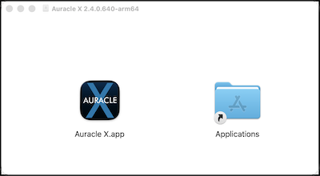

When the Auracle X application has finished downloading open the .dmg file

Drag the Auracle X application to the Applications folder.

### Mac Users: Auracle X update
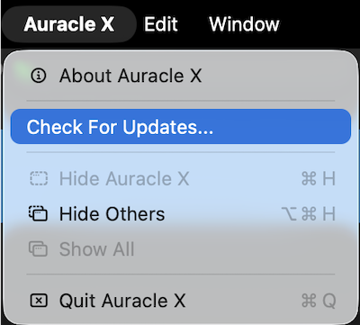

If you already have the Auracle X application installed, use the Auracle X main menu to check for updates and follow the prompts that follow if a newer version of Auracle X is available.

### Windows Users
**First time installation**

When the package installer download is complete, run the Auracle X installer.

Click Yes to allow Auracle X Setup

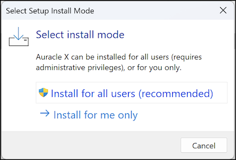

Install for all users

## Updating PlayAUDIO1U Firmware
### Load Latest From Web
To use Auracle X to update your device’s firmware:

1. Ensure your computer is connected to the internet.

2. Connect the PlayAUDIO1U to your computer via the USB DAW A port on your PlayAUDIO1U.

3. Open the Auracle X application.

4. On the PlayAUDIO1U main menu tab click the Firmware menu option

5. If a newer firmware for your device is available a menu option to update firmware will appear in the Load Latest From Web section. Click Install to update from web

### Firmware Update: Load from file

The latest firmware for your device is  also available for manual download at: https://www.iconnectivity.com/firmware

1. Connect the PlayAUDIO1U to your computer via the USB DAW A port on your PlayAUDIO1U.

2. Open the Auracle X application.

3. Click Firmware on the PlayAUDIO1U main menu tab.

4. In the Load From File section click Choose File to call your system file browser and select a firmware file for update.

### Bootloader Mode & Manual Firmware Update

Bootloader Mode is a special service mode used to perform firmware updates. It may be entered automatically (via iConnectivity software Auracle X) or manually (via a specific sequence of manual steps).

The preferred method for updating your device’s firmware is to use iConnectivity software. Our software can check if newer firmware is available and if so, download it into your device. The software method is automated and switches your device modes for you.

In rare situations, you may prefer to manually update your firmware using the bootloader. This will require several steps:

1. Download the firmware from the iConnectivity website Firmware Page

2. Manually set your PlayAUDIO1U interface to Bootloader Mode by following the instructions here

3. Transmit the firmware file to the PlayAUDIO1U and allow the update to complete

4. Manually restart your PlayAUDIO1U by first powering off the device and then powering on again.

### Firmware File Format

iConnectivity firmware is formatted as a Standard MIDI File with a .MID file extension. That means that standard MIDI software such as DAWs, Standard MIDI File Players, and System Exclusive (a.k.a. “SysEx”) applications can be used to transmit the firmware data to your interface. Examples of software that we have tested and can recommend are:

- macOS: [Snoize SysEx Librarian](https://www.snoize.com/SysExLibrarian/)

- windows: [MIDI-OX](http://www.midiox.com/)

## Modes of Operation

iConnectivity interfaces have three modes of operation:

### Power Off
The interface is powered off and not operational.

### Application Mode
This is the normal operational mode that you will use nearly all of the time. In this mode, the device is powered on and operates as a fully functional interface.

### Bootloader Mode
Bootloader Mode is a special service mode used to perform firmware updates. Normally you will use Auracle X software to update your firmware and Auracle X will automatically switch your interface between Normal and Bootloader modes as necessary. In rare situations users may prefer to manually update their firmware via the bootloader. This manual process is described in detail in the [Updating Firmware](#updating-PlayAUDIO1U-firmware) section of this guide.

To manually force your PlayAUDIO1U into Bootloader mode:

1. Power on your PlayAUDIO1U and wait until the bootup process is complete.

2. Long press the main rotary encoder for approximately 6 seconds until all mode buttons illuminate red, then release the encoder

The PlayAUDIO1U will reboot and enter Bootloader mode ready to accept a manual firmware file send.

> **Note:** The PlayAUDIO1U is in Bootloader mode when the OLED display is blank and both the System and Exit Mode buttons alternately flash.

## PlayAUDIO1U Failover Redundancy
### How the PlayAUDIO1U's Failover System Works
Your PlayAUDIO1U unit comes equipped with two independent failover mechanisms: Automatic Failover and Manual Failover. This failover redundancy is designed to ensure that your backup system can always be engaged instantly and seamlessly, whether via auto-detection or through manual switching. Taking advantage of both of these failover mechanisms is recommended for all live performance scenarios.

### Automatic Failover
Automatic Failover uses an audio test tone or MIDI stream sent from your DAW to establish an audio- or MIDI- recognition sync lock between your primary playback device and your PlayAUDIO1U interface on a dedicated internal audio or MIDI channel. Once armed, the PlayAUDIO1U instantly switches to your secondary device if any break in the test tone signal or MIDI stream is detected, providing a seamless failover to your backup system without audio or MIDI interruption. We recommend using the audio tone based failover to prevent needless scene switching when playback is stopped.

### Manual Failover
Manual Failover allows you to control scene switching at the touch of an cap touch button or press of a connected and assigned footswitch. Note that if automatic failover is not armed, the PlayAUDIO1U will NOT switch to your backup playback device in the event of a primary device failure.

### How to Arm the PlayAUDIO1U for Automatic Failover
#### LifeSine Installation

1. Download our LifeSine test tone plugin from https://www.iconnectivity.com/downloads/ and install it on both your primary and backup computers.

2. Insert the LifeSine plugin on an open audio track in your playback session and set the audio output to -10dBFS on the LifeSine audio channel fader to avoid unnecessarily triggering Safe Mode.

#### Playback Computer Setup

1. Copy your original playback session from the steps above to your backup computer, ensuring that both sessions are identical.

2. Connect your primary playback computer to USB DAW Port A and connect your backup playback computer to USB DAW Port B and select the PlayAUDIO1U as the output interface on both computers.

3. Route the LifeSine audio channel to output 35 on both computers.

4. Verify that the PlayAUDIO1U is set to Scene A, or touch the Scene Mode Button to switch to Scene A from Scene B.

5. When your PlayAUDIO1U detects the test tone on the assigned failover detection channel, a blinking shield icon as well as a sine wave icon will appear on the main page of the OLED indicating that the PlayAUDIO1U is armed for automatic failover.

#### Transport Control Setup

1. Connect a MIDI controller to an available USB host or DIN input port and follow your DAW’s instructions to map incoming MIDI messages to DAW transport commands. Both playback sessions must have identical MIDI mapping for correct operation.

> **Note:** When adding the LifeSine plugin to your DAW for the first time it may be necessary to restart your DAW session for the LifeSine plugin to activate.

Refer to Auracle X documentation for detailed instructions including adjusting failover detection channel and threshold at https://www.iconnectivity.com/manuals.

### How to Test Automatic Failover

Ensure that the PlayAUDIO1U is armed for automatic failover by checking for the blinking shield icon on the front panel OLED and that playback has been triggered on both computers. To force failover from Computer A to Computer B, remove the USB cable from USB DAW port A. The PlayAUDIO1U will instantly switch over to Computer B as audio and MIDI playback continues uninterrupted. The Scene Mode Button LED will change to illuminate in red and the OLED will display “B”, indicating that Scene B is now the active scene.

### How to use PlayAUDIO1U Manual Failover

Failover can be engaged manually by touching eithe Scene cap touch buttons on the front panel of the PlayAUDIO1U. The current scene is indicated as follows:  

- Scene A: The upper Scene cap touch OLED is illuminated in green, and the Touch panel display shows the letter “A”

- Scene B: The lower Scene cap touch OLED is illuminated in red, and the Touch panel display shows the letter “B”

For information on how to use a footswitch to initiate manual failover, please see the updated Auracle X manual in the Control Ports section.

### Safe Mode
The Safe Mode feature is integrated into your PlayAUDIO1U interface to safeguard performers and audience members from potentially harmful audio levels. Activation of Safe Mode is indicated by the display of a dedicated Safe Mode screen and alternating red LEDs within the Audio LED section on the front panel. Upon activation, all outputs, excluding the headphone output, will be automatically muted.

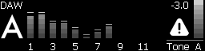

For more information about Safe Mode including Safe Mode triggers and how to disengage Safe Mode and return to normal operation, please see our Safe Mode Guide at https://www.iconnectivity.com/safemode

## Controls

### OLED Home Page Legend

Scene Indicator Icon Legend (Top Left next to Scene A or Scene B Indicator):

| Icon | Info |
| ---       | --- |
| A or B    | Current Scene selection, A or B |
| Checkmark Icon Only           | Tone Check is enabled but no tone is detected |
| Shield with Checkmark Icon    | Tone Check is enabled and tone is detected; Automatic failover engaged |
| Safe Mode Screen              | Audio level on current scene exceeds tone check maximum volume (only used when tone check is enabled). Lower tone volume and double press headphone knob to unmute. For more detailed information about how Safe Mode activates and how to Disengage please visit https://www.iconnectivity.com/safemode  |

Tone and MIDI traffic Indicator Icon Legend (top and bottom right):

| Icon  | Info  |
| ---   | ---   |
| No Icon   | Tone Check not enabled |
| Flat line | Device (computer or tablet) is detected but no tone is detected |
| Sine Wave | Tone Check is enabled and tone is detected |
| MIDI Activity | Monitors general incoming and outgoing MIDI activity |

### Using the Touch Panel and Main Rotary Encoder

The main rotary encoder is continuous and can make fine or coarse adjustments depending on how quickly you rotate the encoder.

Fine adjustments are recommended if there is a risk of signal overload. Rotary Encoder Press functions include:

| Function  | Action    |
| ---       | ---       |
| Commit Settings to Memory | Short press the Main Rotary Encoder twice to save the current state of the PlayAUDIO1U to the current preset. A notification will appear on the OLED and all Mode buttons will flash green three times.   |
| Restart unit  | Long press the main rotary encoder for approximately 10 seconds until all cap touch buttons have turned off after illuminating in red, then release. |
| Enter Bootloader Mode | Long press the main rotary encoder for approximately 6 seconds until all Mode buttons illuminate red and release while buttons are still illuminated red. |
| View Failover Tone information    | From the Home page, turn the encoder clockwise to access audio meter displays showing the current level of the failover tone in both numerical and live metering  No tone will produce a blank meter display above the “Tone A” and “Tone B” labels.  Note that a failover tone level above -3dBFS will cause the PlayAUDIO1U to enter into Safe Mode and all analog and Dante Transmit outputs to be automatically muted.  You will not be able to unmute analog outputs until the failover tone level is adjusted below the threshold displayed on the Tone Meter menu page. |

### OLED Cap Touch Panel

The PlayAUDIO1U features Cap Touch Buttons with fixed functionality for the most commonly used functions of the PlayAUDIO1U.

| Button | Function |
|---|---|
| Scene | Toggles the current scene between scene A and scene B |
| Audio | Displays the audio output menu. Press again to toggle between viewing the 12 rear analog outputs and the home page. When the Output menu is active, turn the encoder to cycle through editable parameters and press the encoder to edit the selected parameter |
| MIDI | Calls the MIDI monitoring page.  Turn the encoder to cycle between MIDI monitoring pages for all PlayAUDIO1U MIDI ports. |
| Exit | Exits to the main page |

#### Scene

Each single touch of either cap touch buttons above or below the Scene label toggles the current scene between A and B. 

The current scene selection is indicated by a large letter A or B on the OLED display or:

Green cap touch button above Scene label for Scene A.

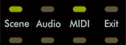

Red cap touch button below Scene label for Scene B.

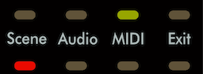

Turn the rotary encoder while on the main page to navigate to the tone check page which shows the current level of the audio failover tone if present.

#### Audio

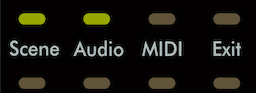

Touch the top or bottom Audio cap touch button to access the Audio menu page displayed below. The main audio page monitors output level of all rear analog outputs and offers the ability to choose any or all outputs for level adjustment.

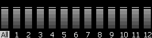

Once the Audio page is active, use the rotary encoder to:

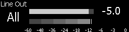

1. Scroll through audio outputs between all, and 1-12 singularly.

2. Short press to select the highlighted audio output or all-output group.

3. Short press again to exit to the main Audio page.

You can also tap the top Audio cap touch button to increment through output channels or tap the bottom cap touch button to decrement through output channels.
---

#### MIDI

The MIDI menu page displays real-time monitoring of all PlayAUDIO1U MIDI inputs and outputs grouped by physical MIDI port.

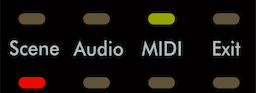

Touch the top or bottom MIDI cap touch button to access the MIDI menu page, displayed below. 

The main MIDI page monitors MIDI traffic at the input or output channels of the selected port.

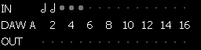

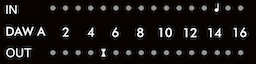

1. Turn to cycle between MIDI port monitor pages: DAW A, DAW B, RTP, USB, DIN.

2. Tap has no function.

Once on the MIDI menu page, turn the main rotary encoder to cycle between MIDI port groups: USB (Host), DIN, DAW A, DAW B, and RTP.

If a MIDI message is detected on an actively monitored MIDI input/output group from the MIDI menu page, a MIDI message-dependent icon will appear in the appropriate input or output row on screen.

| Icon | Info |
|---|---|
| Fader | CC message |
| Music Note | MIDI note message |
| Bold Circle | Clock |
| SX | SysEx message |

---

#### Exit

Press the Exit cap touch button to exit to the main page.

---

### Using the Headphone Rotary Encoder
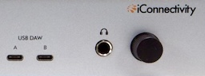
#### Normal Use

The headphone encoder controls the main functions of the headphone port.

Press the headphone encoder to call the headphone mixer menu.

Turn the headphone encoder to adjust the volume of the currently selected headphone mix.

#### Global Mute

Global Mute mutes all rear analog outputs and preserves the headphone output.

Double tap the headphone encoder rapidly to engage Global Mute, muting all analog outputs of the PlayAUDIO1U.

Double tap again while Global Mute is active to unmute.

Turn the encoder slowly to raise or lower the selected headphone mix volume in 0.5 dB increments.

### Using the Control Ports

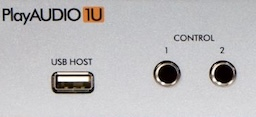

Use the PlayAUDIO1U Control ports with compatible footswitch(es) to Arm/Disarm/Toggle Failover Arm state, load Presets, toggle active scenes, send a spacebar key message, and/or send CC/PC or Note On/Off messages.

Complete instructions on configuring Control port footswitch actions can be found in our [Auracle documentation](https://www.iconnectivity.com/s/auracle-x-user-guide-260-20261013.pdf).

## Specifications

### Audio

**Digital Performance**
- 24-bit resolution
- Supported sample rates: 44.1 kHz, 48 kHz, 88.2 kHz, and 96 kHz

**Line Outputs**

- Maximum Output Level: +16 dBu, 13.83 Vp-p Balanced
- D-A Dynamic Range: 115 dB (-60dBFS, A-weighted)
- D-A S/N: 115 dB (A-weighted)
- D-A THD+N: -107 dB
- D-A Interchannel Isolation: 110 dB (1 kHz, Typical)

**Headphones**

- Maximum Output Level: 100 mW per channel, 5.1 Vp-p into 32-ohm load
- D-A Dynamic Range: 108 dB (-60dBFS, A-weighted)
- D-A S/N: 108 dB (A-weighted)
- D-A THD+N: -91 dB

### MIDI

- 5-pin MIDI DIN I/O
- Up to 16 MIDI ports (256 total MIDI channels) per computer device
- USB Host Port supports up to eight USB MIDI devices (via powered USB hub, not included) 

### USB Host Ports
- Power: +5V DC, 500mA maximum

### USB-C Ports
Connect to Windows or macOS computer(s), Android or iPadOS devices (USB only, Apple Lightning not supported)

### Power
- Input:    100V - 240V AC, 50 - 60 Hz 24W
- Fuse:     1A Slow-Blow

### Dimensions and Weights

- Width:    19” (483 mm)
- Height:  	1.48” (37.5 mm)
- Depth:  	7.81” (200 mm)
- Weight:  	8.73 lbs (3.96 kg) 

## APPENDIX A: MORE RESOURCES

The **iConnectivity website** and **iConnectivity Knowledge Base** contain a wealth of helpful written articles and tutorials, as well as instructional videos. For your convenience, selected hyperlinks into these systems are listed below:

The **iConnectivity Knowledge Base** main page is located at: [iConnectivity Support Website.](https://iconnectivitysupport.zendesk.com/hc/en-us)

Download our latest Unified Windows Driver from the website [Windows Drivers](https://www.iconnectivity.com/windows-drivers) page.

Download **Auracle X** software from the website [Auracle X](https://www.iconnectivity.com/auracle-x-series) page.

Download the latest firmware from the website [Firmware](https://www.iconnectivity.com/firmware) page.

## APPENDIX B: COMPLIANCE

### Compliance Statement

The PlayAUDIO1U meets the requirements of the following standards and directives:
- FCC Part 15 Class B
- CAN ICES-003 (B) / NMB-003 (B)
- CISPR 32 Class B
- EN61000-4-2 | ESD
- EN61000-4-3 | Radiated Immunity
- EN61000-4-4 | EFT
- EN61000-4-5 | Surge Immunity
- EN61000-4-6 | Conducted Immunity
- EN61000-4-8 | Magnetic Immunity
- EN61000-4-11 | VDI
- EN61000-3-2 | Harmonic
- EN61000-3-3 | Flicker
- IEC/EN-62368-1

### Declaration of Conformity

We, iConnectivity, declare that the PlayAUDIO1U complies with Part 15 of the FCC Rules. Operation is subject to the following two conditions: (1) this device may not cause harmful interference, and (2) this device must accept any interference received, including interference that may cause undesired operation.

### Communication Statement
This equipment has been tested and found to comply with the limits for a Class B digital device, pursuant to Part 15 of the FCC Rules.

These limits are designed to provide reasonable protection against harmful interference in a residential installation. This equipment generates, uses and can radiate radio frequency energy and, if not installed and used in accordance with the instructions, may cause harmful interference to radio communications.

However, there is no guarantee that interference will not occur in a particular installation. If this equipment does cause harmful interference to radio or television reception, which can be determined by turning the equipment off and on, the user is encouraged to try to correct the interference by one or more of the following measures:

- Reorient or relocate the receiving antenna.
- Increase the separation between the equipment and receiver.
- Connect the equipment into an outlet on a circuit different from that to which the receiver is connected.
- Consult the dealer or an experienced radio/TV technician for help.

Changes or modifications not expressly approved by iConnectivity could void the user’s authority to operate the equipment.

### Disposal of Waste Equipment by Users in the European Union

*This product must not be disposed of with other waste. Instead, it is your responsibility to dispose of your waste equipment by handing it over to a designated collection point for the recycling of waste electrical and electronic equipment. The separate collection and recycling of your waste equipment at the time of disposal will help conserve natural resources and ensure that it is recycled in a manner that protects human health and the environment. For more information about where you can drop off your waste equipment for recycling, please contact your local city recycling office or the dealer from whom you purchased the product.*
