# PlayAUDIO2U User Guide

## Introduction
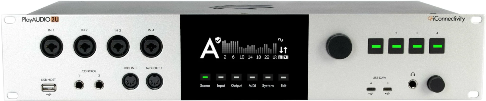

Congratulations on the purchase of your new PlayAUDIO2U USB Audio & MIDI interface!

### Feature List

- Two USB Type C DAW ports – use up to 2 computer devices macOS/Windows simultaneously
- Four XLR/TRS analog Mic, Line, Instrument inputs
- Twenty-four XLR analog audio line outputs 
- Stereo ¼” Headphone output with two independent mixes
- DIN-MIDI ports built-in (front:1-in, 1-out; rear:1-in, 1-out)
- Four USB Host ports (connect up to 8 USB MIDI class-compliant devices with a USB hub)
- Two MIDI mappable CONTROL footswitch ports
- Four MIDI mappable CONTROL buttons
- Two Ethernet RTP-MIDI Network ports 
- Auracle X software (Mac OS, Windows) configuration and setup
- High-resolution audio - up to 24-bit/96kHz AD/DA conversion
- High definition OLED display and tactile user controls, endless multifunction rotary encoders
- 19” rack mountable

### What's in the Box

- 1 PlayAUDIO2U Audio + MIDI interface
- 2 USB-C to USB-C cables
- 1 Each - US, UK, EU type IEC C14 power cables. (Type I is included in Australia)

### Minimum System Requirements
- macOS - macOS 12 or later (for Auracle X control software), One free USB port

- PC/Windows - Windows 10 or later (for Auracle X control software), One free USB port

- iOS - Device must be equipped with a USB-C port and CoreMIDI compatible app

- Android - Android 8.0 or higher with USB-C connector

## Hardware Description

### Front Panel
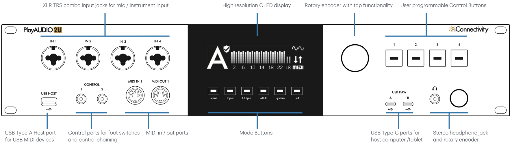

- **XLR TRS Combo Jack** Plug in microphones, line-level devices, DI boxes, or instruments.
- **USB HOST Port.** Directly plug in a class-compliant MIDI device, or plug in up to eight class-compliant MIDI devices via a powered USB hub (not included).
- **CONTROL Ports.** Plug in up to two foot switches or chain multiple PlayAUDIO interfaces.
- **MIDI DIN Ports.** 5 pin DIN connections for MIDI Controllers.
- **High Resolution OLED display.** Inspect real time MIDI and audio information.
- **Mode Buttons.** Select PlayAUDIO2U menu functions such as scene, audio inputs and outputs, and MIDI.
- **Rotary Encoder.** Multi-function encoder. Double press to save current settings or turn encoder to change page, change selection, or change value.
- **USB DAW Ports.** USB Type C ports for connecting host computers or tablets.
- **Control Buttons.** User programmable control buttons.
- **¼-inch Headphone Port.** Stereo mix.
- **Headphone Rotary Encoder.** Multi-function encoder. Turn to increase or decrease the headphone mix output volume; turning also temporarily calls up the headphone volume display. Press once to call the headphone volume display, and press again to return to the previous active menu. Additionally, double press to mute and unmute all analog outputs.

### Rear Panel
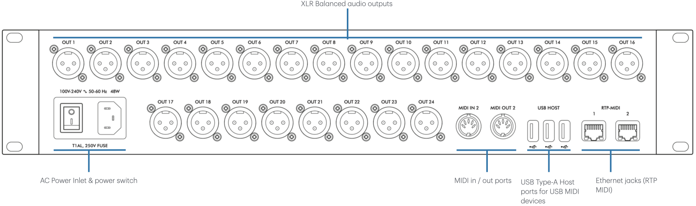

- **AC Power Inlet.** Fused Input jack for included IEC C13 power supply cable.
- **Power switch.** Turn the PlayAUDIO2U on or off. The switch will illuminate when power is turned on. 
- **XLR Balanced Audio Outputs.** The PlayAUDIO2U's 24 analog outputs provide low noise, phantom power-resistant connections with up to 24-bit/96kHz DA conversion.
- **MIDI DIN Ports.** 5 pin DIN connections for MIDI Controllers.
- **USB HOST Ports.** Directly plug in a class-compliant MIDI device, or plug in up to eight class-compliant MIDI devices via a powered USB hub (not included).
- **RTP MIDI Ports.** Make long distance MIDI connections over ethernet.

## Getting Started

### Mac Users
There are no software drivers to download or install; the PlayAUDIO2U interface uses the USB MIDI class-compliant drivers built into macOS.

### Windows - Install iConnectivity Audio Drivers
Before connecting the PlayAUDIO2U to a Windows computer please download and install the latest version of our Unified Windows Driver at https://www.iconnectivity.com/windows-drivers.

Connect your computer to your PlayAUDIO2U USB DAW Port A using a USB 2.0 or better data cable.

The interface should appear as a standard audio output device in Windows. You can route audio from music or video apps directly to the interface to test.

### Auracle X configuration software from iConnectivity
Quick and simple configuration of the PlayAUDIO2U is possible via onboard controls but deep customization is available via our Auracle X application.

Read on in the Auracle X section below for more information.

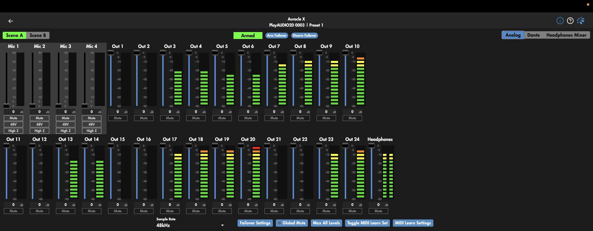

> **Note:** All analog output volumes including the headphones output are muted by default and need to be raised for monitoring.

## Recommended Software Installation

### Windows - Install iConnectivity RTP MIDI Driver for Network MIDI

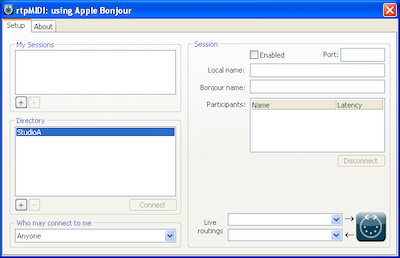

The RTP-MIDI driver for Network MIDI can be found at https://www.iconnectivity.com/windows-drivers

Apple Bonjour Print Services for Windows is also required for RTP session discovery over network via bonjour and is available at:
https://support.apple.com/en-us/106380

Launch the rtpMIDISetup Application and follow all prompts to install.

> **Note:** After installing the RTP-MIDI driver and Apple Bonjour Print Services be sure to restart your computer in order for the RTP-MIDI driver to default to using Apple Bonjour instead of lightweight mDNS for RTP session discovery.

### MIDI Monitoring tools

MIDI monitoring applications are very useful for routing debugging and troubleshooting. We recommend these free tools for your operating system:

Windows: [MIDI-OX](http://www.midiox.com/)

MacOS: [Snoize MIDI monitor and Sysex Librarian](http://www.midiox.com/)

## Installing Auracle X
Before you begin using your PlayAUDIO2U we recommend that you upgrade your unit's firmware to the latest version using iConnectivity's Auracle X application.

Download the latest version of the Auracle X software installer at: https://www.iconnectivity.com/software/control-software

### Mac Users

## First time Installation

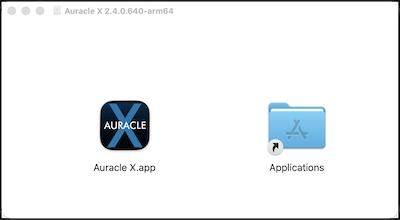

When the Auracle X application has finished downloading open the .dmg file

Drag the Auracle X application to the Applications folder.

### Mac Users: Auracle X update

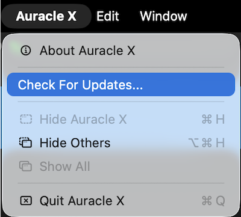

If you already have the Auracle X application installed, use the Auracle X main menu to check for updates and follow the prompts that follow if a newer version of Auracle X is available.

### Windows Users

**First time installation**

When the package installer download is complete, run the Auracle X installer.

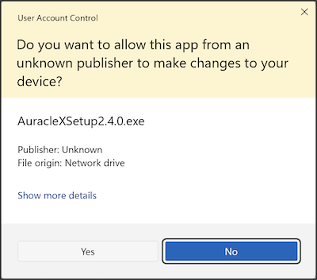

Click Yes to allow Auracle X Setup

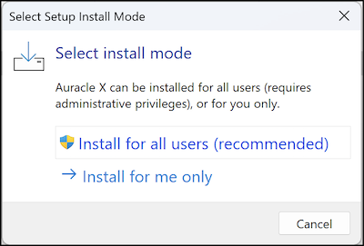

Install for all users.

## Updating PlayAUDIO2U Firmware

### Load Latest From Web

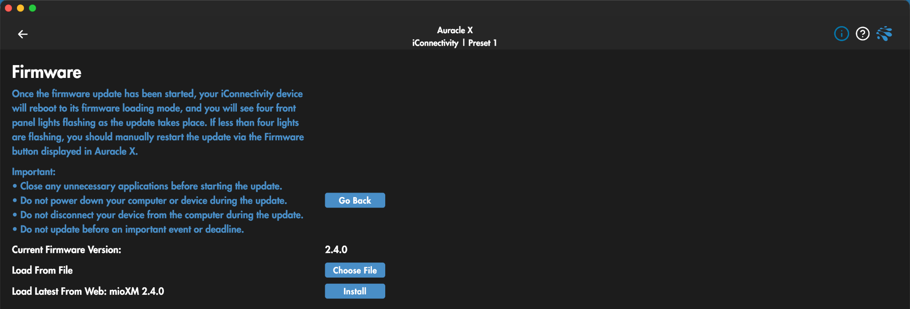

To use Auracle X to update your device’s firmware:

1. Ensure your computer is connected to the internet.

2. Connect the PlayAUDIO2U to your computer via the USB DAW A port on your PlayAUDIO2U.

3. Open the Auracle X application.

4. On the PlayAUDIO2U main menu tab click the Firmware menu option.

5. If a newer firmware for your device is available a menu option to update firmware will appear in the Load Latest From Web section. Click Install to update from web.

### Firmware Update: Load from file

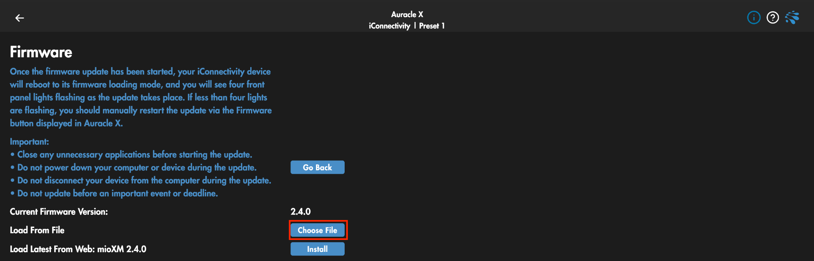

The latest firmware for your device is  also available for manual download at: https://www.iconnectivity.com/firmware

1. Connect the PlayAUDIO2U to your computer via the USB DAW A port on your PlayAUDIO2U.

2. Open the Auracle X application.

3. Click Firmware on the PlayAUDIO2U main menu tab.

4. In the Load From File section click Choose File to call your system file browser and select a firmware file for update.

### Bootloader Mode & Manual Firmware Update

Bootloader Mode is a special service mode used to perform firmware updates. It may be entered automatically (via iConnectivity software Auracle X) or manually (via a specific sequence of manual steps).

The preferred method for updating your device’s firmware is to use iConnectivity software. Our software can check if newer firmware is available and if so, download it into your device. The software method is automated and switches your device modes for you.

In rare situations, you may prefer to manually update your firmware using the bootloader. This will require several steps:

1. Download the firmware from the iConnectivity website Firmware Page

2. Manually set your PlayAUDIO2U interface to Bootloader Mode by following the instructions here

3. Transmit the firmware file to the PlayAUDIO2U and allow the update to complete

4. Manually restart your PlayAUDIO2U by first powering off the device and then powering on again.

### Firmware File Format

iConnectivity firmware is formatted as a Standard MIDI File with a .MID file extension. That means that standard MIDI software such as DAWs, Standard MIDI File Players, and System Exclusive (a.k.a. “SysEx”) applications can be used to transmit the firmware data to your interface. Examples of software that we have tested and can recommend are:

- macOS: [Snoize SysEx Librarian](https://www.snoize.com/SysExLibrarian/)

- windows: [MIDI-OX](http://www.midiox.com/)

## Modes of Operation

iConnectivity interfaces have three modes of operation:

### Power Off

The interface is powered off and not operational.

### Application Mode

This is the normal operational mode that you will use nearly all of the time. In this mode, the device is powered on and operates as a fully functional interface.

### Bootloader Mode

Bootloader Mode is a special service mode used to perform firmware updates. Normally you will use Auracle X software to update your firmware and Auracle X will automatically switch your interface between Normal and Bootloader modes as necessary. In rare situations users may prefer to manually update their firmware via the bootloader. This manual process is described in detail in the [Updating Firmware](#updating-playaudio2u-firmware) section of this guide.

To manually force your PlayAUDIO2U into Bootloader mode:

1. Power on your PlayAUDIO2U and wait until the bootup process is complete.

2. Long press the main rotary encoder for approximately 6 seconds until all mode buttons illuminate red, then release the encoder.

The PlayAUDIO2U will reboot and enter Bootloader mode ready to accept a manual firmware file send.

> **Note:** The PlayAUDIO2U is in Bootloader mode when the OLED display is blank and both the System and Exit Mode buttons alternately flash.

## PlayAUDIO2U Failover Redundancy

### How the PlayAUDIO2U's Failover System Works

The PlayAUDIO2U is capable of automatically switching audio and MIDI input sources from primary to backup devices by monitoring a constant, inaudible failover signal. You may also choose to manually fail over to your backup device using the onboard Scene Mode button.

### Automatic Failover

Automatic failover protection is achieved by routing a constant audio test signal from your primary playback device plugged into USB DAW port A to a virtual audio output on the PlayAUDIO2U. When an interruption is detected in the test signal (usually caused by CPU spikes, DAW crashes or skips), the PlayAUDIO2U will swap input sources to the backup device plugged into USB DAW port B.

### Manual Failover

Manual failover allows you to control scene switching at the touch of the Scene Mode button or press of a connected and assigned footswitch. 

### How to Arm the PlayAUDIO2U for Automatic Failover

#### LifeSine Installation

1. Download our LifeSine test tone plugin from https://www.iconnectivity.com/downloads/ and install it on both your primary and backup computers.

2. Insert the LifeSine plugin on an open audio track in your playback session and set the audio output to -10dBFS on the LifeSine audio channel fader to avoid unnecessarily triggering Safe Mode.

#### Playback Computer Setup

1. Copy your original playback session from the steps above to your backup computer, ensuring that both sessions are identical.

2. Connect your primary playback computer to USB DAW Port A and connect your backup playback computer to USB DAW Port B and select the PlayAUDIO2U as the output interface on both computers.

3. Route the LifeSine audio channel to output 35 on both computers.

4. Verify that the PlayAUDIO2U is set to Scene A, or touch the Scene Mode Button to switch to Scene A from Scene B.

5. When your PlayAUDIO2U detects the test tone on the assigned failover detection channel, a blinking shield icon as well as a sine wave icon will appear on the main page of the OLED indicating that the PlayAUDIO2U is armed for automatic failover.

#### Transport Control Setup

1. Connect a MIDI controller to an available USB host or DIN input port and follow your DAW’s instructions to map incoming MIDI messages to DAW transport commands. Both playback sessions must have identical MIDI mapping for correct operation.

> **Note:** When adding the LifeSine plugin to your DAW for the first time it may be necessary to restart your DAW session for the LifeSine plugin to activate.

Refer to Auracle X documentation for detailed instructions including adjusting failover detection channel and threshold at https://www.iconnectivity.com/manuals.

### How to Test Automatic Failover

Ensure that the PlayAUDIO2U is armed for automatic failover by checking for the blinking shield icon on the front panel OLED and that playback has been triggered on both computers. To force failover from Computer A to Computer B, remove the USB cable from USB DAW port A. The PlayAUDIO2U will instantly switch over to Computer B as audio and MIDI playback continues uninterrupted. The Scene Mode Button LED will change to illuminate in red and the OLED will display “B”, indicating that Scene B is now the active scene.

### How to use PlayAUDIO2U Manual Failover

Failover can be engaged manually by touching the Scene Mode Button on the front panel of the PlayAUDIO2U. The current scene is indicated as follows:

- Scene A: The Scene Mode Button is illuminated in green, and the Touch panel display shows the letter “A”.

- Scene B: The Scene Mode Button is illuminated in red, and the Touch panel display shows the letter “B”.

[Comment]: # (NEED LINK to Auracle X manual)
For information on how to use a footswitch to initiate manual failover, please see the updated Auracle X manual in the Control Ports section.

### Safe Mode

The Safe Mode feature is integrated into your PlayAUDIO2U interface to safeguard performers and audience members from potentially harmful audio levels. Activation of Safe Mode is indicated by the display of a dedicated Safe Mode screen and alternating red LEDs within the Audio LED section on the front panel. Upon activation, all outputs, excluding the headphone output, will be automatically muted.

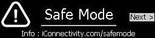

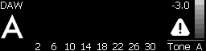

For more information about Safe Mode including Safe Mode triggers and how to disengage Safe Mode and return to normal operation, please see our Safe Mode Guide at https://www.iconnectivity.com/safemode

## Controls

### OLED Home Page Legend

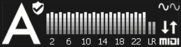

Scene Indicator Icon Legend (Top Left next to Scene A or Scene B Indicator):

| Icon | Info |
| ---       | --- |
| **A or B**  | Current Scene selection, A or B |
| **Checkmark Icon Only**           | Tone Check is enabled but no tone is detected |
| **Shield with Checkmark Icon**    | Tone Check is enabled and tone is detected; Automatic failover engaged |
| **Safe Mode Screen**              | Audio level on current scene exceeds tone check maximum volume (only used when tone check is enabled). Lower tone volume and double press headphone knob to unmute. For more detailed information about how Safe Mode activates and how to Disengage please visit https://www.iconnectivity.com/safemode  |

Tone and MIDI traffic Indicator Icon Legend (top and bottom right):

| Icon  | Info  |
| ---   | ---   |
| **No Icon**   | Tone Check not enabled |
| **Flat line** | Device (computer or tablet) is detected but no tone is detected |
| **Sine Wave** | Tone Check is enabled and tone is detected |
| **MIDI Activity** | Monitors general incoming and outgoing MIDI activity |

### Using the Main Rotary Encoder

The main rotary encoder is continuous and can make fine or coarse adjustments depending on how quickly you rotate the encoder.

Fine adjustments are recommended if there is a risk of signal overload. Rotary Encoder Press functions include:

| Function  | Action    |
| ---       | ---       |
| **Commit Settings to Memory** | Short press the Main Rotary Encoder twice to save the current state of the PlayAUDIO2U to the current preset. A notification will appear on the OLED and all Mode buttons will flash green three times.   |
| **Restart unit**  | Long press the main rotary encoder for approximately 10 seconds until all Mode buttons have turned off after illuminating in red, then release. |
| **Enter Bootloader Mode** | Long press the main rotary encoder for approximately 6 seconds until all Mode buttons illuminate red and release while buttons are still illuminated red. |
| **View Failover Tone information**    | From the Home page, turn the encoder clockwise to access audio meter displays showing the current level of the failover tone in both numerical and live metering  No tone will produce a blank meter display above the “Tone A” and “Tone B” labels.  Note that a failover tone level above -3dBFS will cause the PlayAUDIO2U to enter into **Safe Mode** and all analog outputs to be automatically muted.  You will not be able to unmute analog outputs until the failover tone level is adjusted below the threshold displayed on the Tone Meter menu page. |

### Mode Buttons
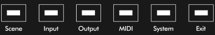

The PlayAUDIO2U features Mode Buttons with fixed functionality for the most commonly used functions of the PlayAUDIO2U.

| Button | Function |
|---|---|
| **Scene** | Toggles between active scenes |
| **Input** | Displays the audio input menu.  When the Input menu is active, press to select an input channel. Press again to advance to next input channel with wraparound |
| **Output** | Displays the audio output menu. When the Output menu is active press to select an output channel. Press again to advance to next output channel with wraparound |
| **MIDI** | Calls the MIDI monitoring page. Turn the encoder to cycle between MIDI monitoring pages for all PlayAUDIO2U MIDI ports. Double tap the encoder while the MIDI page is active to generate a MIDI Panic message to all MIDI ports |
| **System** | Displays the PlayAUDIO2U info page |
| **Exit** | Steps backward through the menu hierarchy per press |

#### Scene
The Scene page displays current output metering per channel on the currently active scene.

Press the scene button to toggle the PlayAUDIO2U between Scene A and Scene B.

Rotate the encoder to move between the pages listed below, and short press to select one:

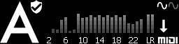

1. Analog output monitoring including headphones, scene indicator, failover tone detection, and MIDI monitor
    - Short press to call the edit output channel window, where all or one of 24 analog output channels may be selected to edit.
    - Press Exit to climb out of the menu hierarchy.

2. Analog input monitoring including phantom and HiZ indicators
    - Short press to call the edit analog input channel window, where all or one of four analog input channels may be selected to edit.
    - Press Exit to climb out of the menu hierarchy.

3. Failover Tone Meter Monitoring including threshold setting
    - Press to call the output plus Tone Meter Monitoring window where you can view all 32 output meters plus failover tone
    - Turn to select between monitoring DAW A or DAW B

Each page will have varying selectable parameters. Short press the encoder to select editable parameters; rotate the encoder to change the value of the selected parameter.

#### Input
The Input page monitors and edits analog input channels.

Press the Input Mode button to call the Analog Input menu.

##### Analog Input monitoring
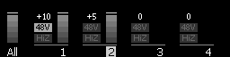

The Input page displays analog input gain level and active input metering, 48V and Hi-Z status on analog inputs and allows you to edit these parameters.

##### Editing Analog Input Channels

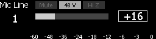

Once a single audio input channel or all audio input channels are selected, a detailed menu of editable input parameters appears.

Rotate the main encoder to toggle between editable audio input parameters and short press the main encoder to edit the selected parameter.

Turn the main encoder to change the value of the selected parameter. Press the main encoder again to select another editable parameter.

#### Output

The Output page monitors and edits all 24 rear analog output channels.

Press the Output Mode button to call the Output menu.

Rotate the main encoder to select a single channel or all channels. Short press the main encoder to edit the selected output channel(s).

##### Analog Output Monitoring

The Output page displays active analog output metering and allows you to edit these parameters.

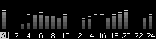

##### Editing Analog Output Channels

Select a single or all analog output channels by turning the encoder to the channel(s) you wish to edit and pressing the encoder.

A detailed menu of editable audio output parameters appears.

Rotate the main encoder to toggle between editable audio output parameters and short press the main encoder to edit the selected parameter.

Turn the main encoder to change the value of the selected parameter.

Short press the main encoder again to unselect the edited parameter.

You can also press the Output Mode button to step through all outputs one at a time, then all twenty-four outputs.

Continuing to short press the Output Mode Button will wrap around to the first audio output channel.

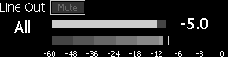

#### MIDI

The MIDI menu page displays real-time monitoring of all PlayAUDIO2U MIDI inputs and outputs grouped by physical MIDI port.

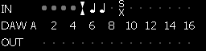

Press the MIDI Mode button to call the PlayAUDIO2U’s onboard MIDI monitor page.

Double-tapping the MIDI Mode button will send a MIDI Panic message to all MIDI outputs.

---

Once on the MIDI menu page, turn the main rotary encoder to cycle between MIDI port groups: USB (Host), DIN, DAW A, DAW B, and RTP.

---

If a MIDI message is detected on an actively monitored MIDI input/output group from the MIDI menu page, a MIDI message-dependent icon will appear in the appropriate input or output row on screen.

| Icon | Info |
|---|---|
| Fader | CC message |
| Music Note | MIDI note message |
| Bold Circle | Clock |
| SX | SysEx message |

#### System

Press the System Mode Button to display the PlayAUDIO2U info page

#### Exit

Press the Exit Mode button to step out of the currently active menu hierarchy.

### Using the Headphone Rotary Encoder

#### Normal Use

The headphone encoder controls the main functions of the headphone port.

Press the headphone encoder to call the headphone mixer menu.

Turn the headphone encoder to adjust the volume of the currently selected headphone mix.

#### Global Mute

Global Mute mutes all rear analog outputs and preserves the headphone output.

Double tap the headphone encoder rapidly to engage Global Mute.

Double tap again while Global Mute is active to unmute.

#### Headphone Mixes

Each active Scene on the PlayAUDIO2U has four headphone mix options.

To select between headphone mixer options:

1. Press the headphone encoder to call the headphone mix menu for the currently active Scene. Press again to exit.

2. Turn the headphone encoder slowly to raise or lower the selected headphone mix volume in 0.5 dB increments.

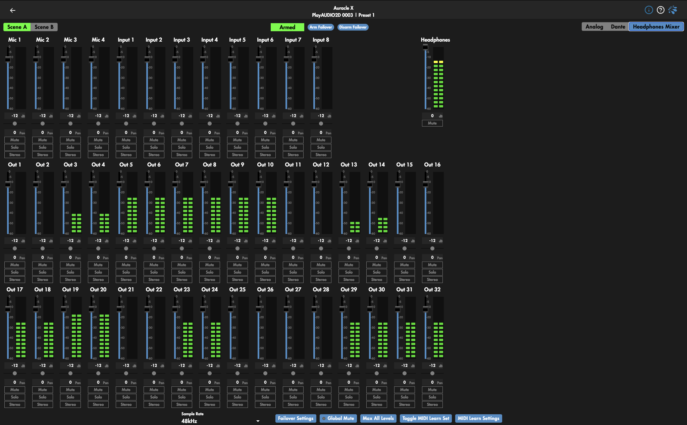

#### Headphone Mix Options: Scene A

##### Mix A1
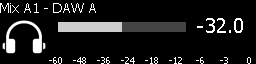

- All 24 outputs from USB DAW A
- All four analog inputs

##### Mix A2

- All 32 outputs from USB DAW A
- All four analog inputs

##### Mix A3

- All 32 outputs from USB DAW B
- All four analog inputs

##### Mix A4

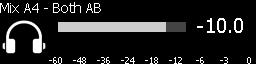

- USB DAW A outputs 1-12; USB DAW B outputs 1-12
- All four analog inputs

#### Headphone Mix Options: Scene B

##### Mix B1

- All 24 outputs from USB DAW B
- All four analog inputs

##### Mix B2

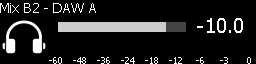

- All 24 outputs from USB DAW A
- All four analog inputs

##### Mix B3

- All 24 outputs from USB DAW B
- All four analog inputs

##### Mix B4

- USB DAW A outputs 1-12; USB DAW B outputs 1-12
- All four analog inputs

### Control Buttons

By default, each control button is mapped to a different MIDI note and transmits on MIDI channel 16 on the control port. Pressing a control button sends a Note On message (velocity 99),  and releasing a control button sends a Note Off message (velocity 0).

From left to right, the default MIDI note programming is:

| Button | Note |
| --- | --- |
| Button 1:	| Note 36 |
| Button 2:	| Note 39 |
| Button 3:	| Note 41 |
| Button 4:	| Note 38 |

Each Control button can also be custom mapped to a MIDI note, CC parameter and single value.

### Using the Control Ports and Control Buttons

Use the PlayAUDIO2U Control ports with a compatible footswitch to Arm/Disarm/Toggle Failover Arm state, load Presets, toggle active scenes, send a spacebar key message, and/or send CC/PC or Note On/Off messages.

The PlayAUDIO2U Control Buttons have the same programmable functionality as the user mappable Control ports described above.

Complete instructions on configuring Control port footswitch actions can be found in our [Auracle documentation](https://www.iconnectivity.com/s/auracle-x-user-guide-260-20261013.pdf).

## Specifications

### Audio

**Digital Performance**
- 24-bit resolution
- Supported sample rates: 44.1 kHz, 48 kHz, 88.2 kHz, and 96 kHz

**Audio Inputs**
- Available Gain: 0 to +60 dB
- Maximum Input Level: +16 dBu (13.83 Vp-p) balanced at 0 gain
- XLR Inputs:	Mic Inputs with software and front panel controlled Gain, Mute and +48V Phantom Power
- TRS Inputs:	Line Inputs with software and front panel controlled Gain, Mute and High-Z Instrument Impedance

**Line Outputs**
- Maximum Output Level: +16 dBu, 13.83 Vp-p Balanced
- D-A Dynamic Range: 115 dB (-60dBFS, A-weighted)
- D-A S/N: 115 dB (A-weighted)
- D-A THD+N: -107 dB
- D-A Interchannel Isolation: 110 dB (1 kHz, Typical)

**Headphones**
- Maximum Output Level: 100 mW per channel, 5.1 Vp-p into 32-ohm load
- D-A Dynamic Range: 108 dB (-60dBFS, A-weighted)
- D-A S/N: 108 dB (A-weighted)
- D-A THD+N: -91 dB

### MIDI

- Two pairs 5-pin MIDI DIN I/O
- Up to 16 MIDI ports (256 total MIDI channels) per computer device

### USB Host Ports

- Four USB Host ports supporting a total of up to eight USB MIDI devices via powered USB hubs (not included).
- Power: +5V DC, 500mA maximum per port

### USB-C Ports

Connect to Windows or macOS computer(s), Android or iPadOS devices (USB only, Apple Lightning not supported)

### Power

- Input:  	100V - 240V AC, 50 - 60 Hz, 48W
- Fuse: 	1A Slow-Blow

### Dimensions and Weights

- Width:	19” (482 mm)
- Height:   3.43” (87 mm)
- Depth:  	7.87” (200 mm)
- Weight:  	8.38 lbs (3.8 kg)

## APPENDIX A: More Resources

The **iConnectivity website** and **iConnectivity Knowledge Base** contain a wealth of helpful written articles and tutorials, as well as instructional videos. For your convenience, selected hyperlinks into these systems are listed below:

The **iConnectivity Knowledge Base** main page is located at: [iConnectivity Support Website.](https://iconnectivitysupport.zendesk.com/hc/en-us)

Download our latest Unified Windows Driver from the website [Windows Drivers](https://www.iconnectivity.com/windows-drivers) page.

Download **Auracle X** software from the website [Auracle X](https://www.iconnectivity.com/auracle-x-series) page.

Download the latest firmware from the website [Firmware](https://www.iconnectivity.com/firmware) page.

## APPENDIX B: Compliance

### Compliance Statement

The PlayAUDIO2U meets the requirements of the following standards and directives:
- FCC Part 15 Class B
- CAN ICES-003 (B) / NMB-003 (B)
- CISPR 32 Class B
- EN61000-4-2 | ESD
- EN61000-4-3 | Radiated Immunity
- EN61000-4-4 | EFT
- EN61000-4-5 | Surge Immunity
- EN61000-4-6 | Conducted Immunity
- EN61000-4-8 | Magnetic Immunity
- EN61000-4-11 | VDI
- EN61000-3-2 | Harmonic
- EN61000-3-3 | Flicker
- IEC/EN-62368-1

### Declaration of Conformity

We, iConnectivity, declare that the PlayAUDIO2U complies with Part 15 of the FCC Rules. Operation is subject to the following two conditions: (1) this device may not cause harmful interference, and (2) this device must accept any interference received, including interference that may cause undesired operation.

### Communication Statement
This equipment has been tested and found to comply with the limits for a Class B digital device, pursuant to Part 15 of the FCC Rules.

These limits are designed to provide reasonable protection against harmful interference in a residential installation. This equipment generates, uses and can radiate radio frequency energy and, if not installed and used in accordance with the instructions, may cause harmful interference to radio communications.

However, there is no guarantee that interference will not occur in a particular installation. If this equipment does cause harmful interference to radio or television reception, which can be determined by turning the equipment off and on, the user is encouraged to try to correct the interference by one or more of the following measures:

- Reorient or relocate the receiving antenna.
- Increase the separation between the equipment and receiver.
- Connect the equipment into an outlet on a circuit different from that to which the receiver is connected.
- Consult the dealer or an experienced radio/TV technician for help.

Changes or modifications not expressly approved by iConnectivity could void the user’s authority to operate the equipment.

### Disposal of Waste Equipment by Users in the European Union

*This product must not be disposed of with other waste. Instead, it is your responsibility to dispose of your waste equipment by handing it over to a designated collection point for the recycling of waste electrical and electronic equipment. The separate collection and recycling of your waste equipment at the time of disposal will help conserve natural resources and ensure that it is recycled in a manner that protects human health and the environment. For more information about where you can drop off your waste equipment for recycling, please contact your local city recycling office or the dealer from whom you purchased the product.*

---